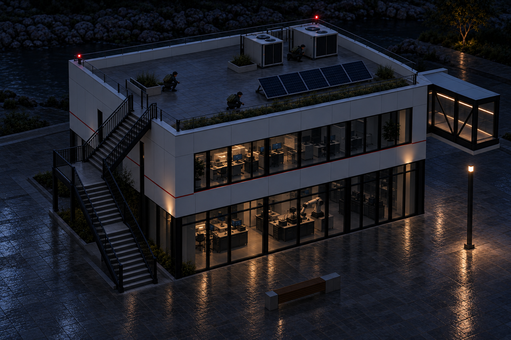
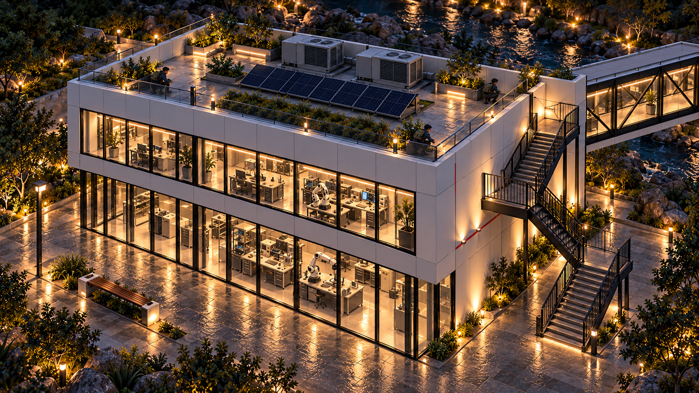
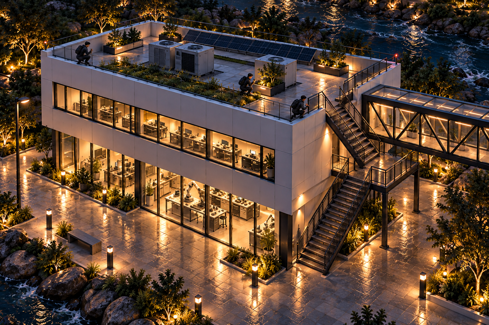
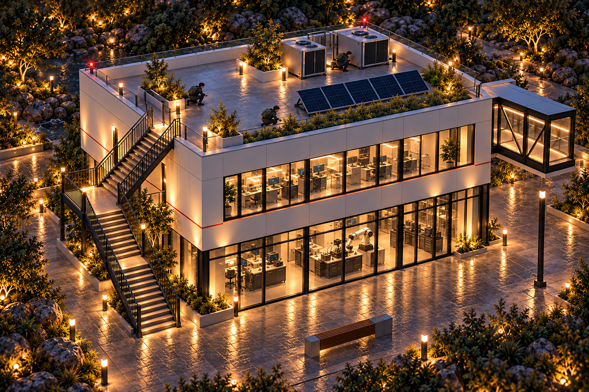
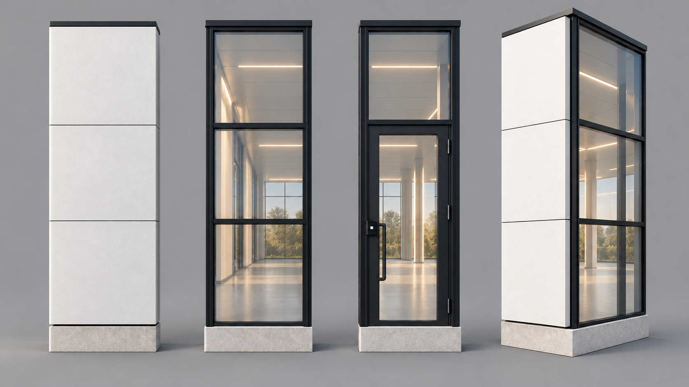
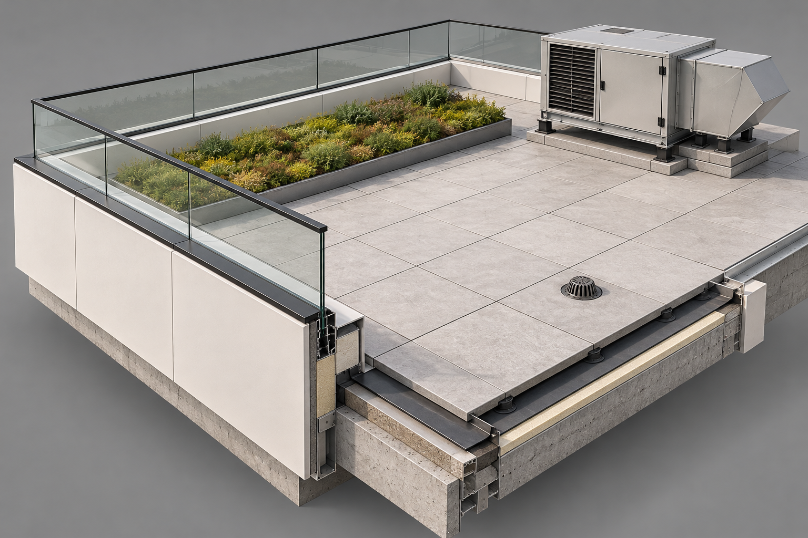
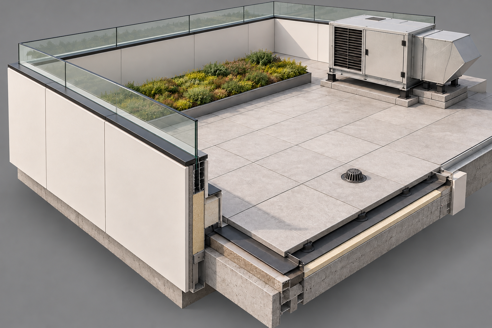
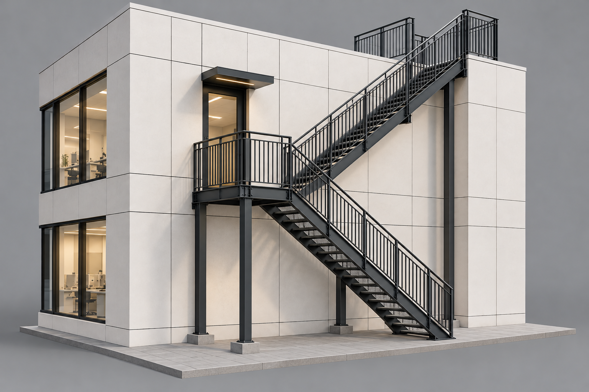
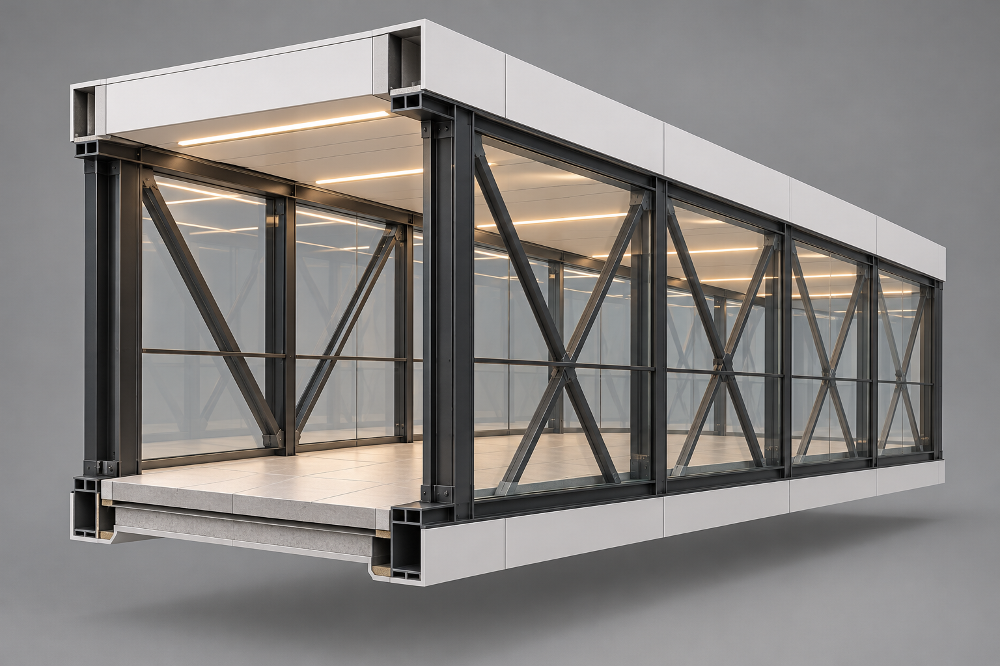

# Architecture slice look — Request 31

October 18, 2026. Three target-frame candidates (A, B and revised C), plus four element sheets and their preserved first passes. Generated with the built-in image generation tool from the references in [Claude's brief](../../briefs/architecture-slice-look.md).

Status: lighting and planting revision C v3 ready for Bryson's review. No visual selection or source promotion is recorded. These are look targets for Claude's Blender/Godot slice; they are not Meshy inputs or a tested game build.

## Bryson's lighting and planting correction

Bryson's feedback, October 18: too many lights, everything too bright, and too much greenery. The earlier target frames below are preserved as history; their lighting and landscaping are superseded by this correction.

C v3 removes the repeated garden/path lights, dims most lab bays, reduces the warm wall wash and wet reflections, and clears much of the planting. The building, camera composition, stair, bridge and three roof Operators are retained. The exact reduction used in the prompt is an implementation choice, not a new numeric game rule. The element sheets remain neutral-light material/shape references; final lighting and planting density should follow the revised target after selection.

## Suggested review set

This is Astra's recommendation, not Bryson's selection.

| Deliverable | Suggested candidate | What to inspect |
|---|---|---|
| Target frame | [C v3, lighting and planting revised](01-target-frame-c-v3.png) | Fewer lights, darker interiors and paving, much less greenery; complete stair and bridge stub, three roof Operators and two rooftop units. |
| Wall bays | [B](02-wall-bays-b.png) | Solid, glass, door and outside corner; corrected three-row panel/glazing rhythm. |
| Roof edge and terrace | [A](03-roof-edge-terrace-a.png) | Lower opaque edge and glass guard, closer to the current approved plan and target frame. B shows the brief's taller opaque-wall interpretation. |
| Outside stair | [B](04-outside-stair-b.png) | Corrected ground connection, two flights, intermediate door landing and roof arrival. |
| Skybridge section | [A](05-skybridge-section-a.png) | Black frame, glass, X bracing, pale floor, white underside/fascia and warm linear lights. |

## Build handoff and remaining differences

- The brief prescribes a 1.5 m panel/mullion module, 4.5 m storeys, about a 12 × 9 m lab, a 1.5 m-wide stair and a 3 m-wide bridge. These were explicit prompt constraints. Raster concepts cannot establish their exact dimensions; Claude's geometry and native camera remain the scale authority.
- There is a source discrepancy: the [brief](../../briefs/architecture-slice-look.md) says a **1.1 m white parapet with glass above**, while the now-approved [slice plan](../../../explorations/architecture.md#kit-dimensions) says **parapet and railing: 1.1 m**. Roof B follows the brief's literal taller opaque wall. Roof A and the target frames retain a lower opaque roof edge with taller glazing, closer to the approved combined-height intent. Recommend roof A for that plan; roof B is an alternate interpretation and does not supersede the approved dimensions.
- C revised is the strongest complete composition: both stair flights, the bridge endpoint, all three people and two rooftop units are visible. It remains a generated perspective image, not a verified 50-degree battle-camera capture. The bridge landing height, building footprint, panel grid and stair rise/run need the prescribed dimensions in the build.
- Target frames convey the lighting and materials. The element sheets provide closer construction-look references. Their generation adds no decisions beyond the approved slice plan and does not change traversal/combat rules.
- The images show an illuminated lab behind glass. This does not change the exploration's plan to create apparent interior depth with a shader.
- Visual inspection checked the requested components, people/equipment counts, stair continuity, framing and absence of obvious labels or logos. The wall subdivision, roof parapet and stair foot received targeted corrections. No Godot import, game integration or playtest was performed.

## Earlier target-frame candidates — lighting and planting superseded

### A — first camera/composition

Three roof people and two rooftop units. The outside stair gained an extra flight, and the bridge continues beyond the frame. Use for lighting/material comparison.

### B — alternate composition

Three roof people. This version adds a third rooftop unit and crops the bridge. Use for lighting/material comparison.

### C v2 — earlier framing revision

Complete short bridge stub, two stair flights reaching the ground and roof, three visible Operators, and two rooftop units. See the dimensional and roof-edge qualifications above.

## Element sheets

### Wall bays B

### Roof edge and terrace A — closer to the approved combined guard height

### Roof edge and terrace B — literal brief interpretation

### Outside stair B

### Skybridge section A

## Preserved first passes

These document the targeted revisions; the floating stair foot in stair A is a known error.

| First pass | Reason revised |
|---|---|
| [Wall bays A](02-wall-bays-a.png) | Half-width white-panel seam and a two-row subdivision instead of three equal module rows. |
| [Roof edge A](03-roof-edge-terrace-a.png) | Low opaque curb, inconsistent with the brief's literal 1.1 m solid parapet. |
| [Outside stair A](04-outside-stair-a.png) | Lower flight terminated above the ground. B extends it down to the paving. |
| [Target C first pass](01-target-frame-c.png) | Only two people and a cropped bridge; the revision restores three people and includes the complete stub. |

## Prompts and provenance

- [Initial prompts and ordered references](prompts.md)
- [Targeted refinement prompts](refinement-prompts.md)
- [Target C final correction prompt](target-frame-c-revision-prompt.md)
- [Bryson's lighting and planting revision prompt](lighting-and-planting-revision-prompt.md)
- [Generation record](generation-record.json): exact effective prompts, ordered references and hashes, generator output paths, workspace filenames, native dimensions, byte sizes and SHA-256 hashes.

All twelve PNG outputs are copied byte for byte from the generator. None was resized, cropped, repainted or resampled after generation. The revised images are new image-tool outputs; the earlier outputs remain available for comparison.

## After Bryson picks

Copy the chosen images unchanged to `art/sources/architecture/slice/` as `01-target-frame.png`, `02-wall-bays.png`, `03-roof-edge-terrace.png`, `04-outside-stair.png` and `05-skybridge-section.png`. Record Bryson's choices and then mark Request 31 delivered with a link to this gallery. Follow the approved combined guard height unless Bryson changes it; the taller interpretation in roof B needs an explicit choice. Until selection, the source folder is unchanged.
