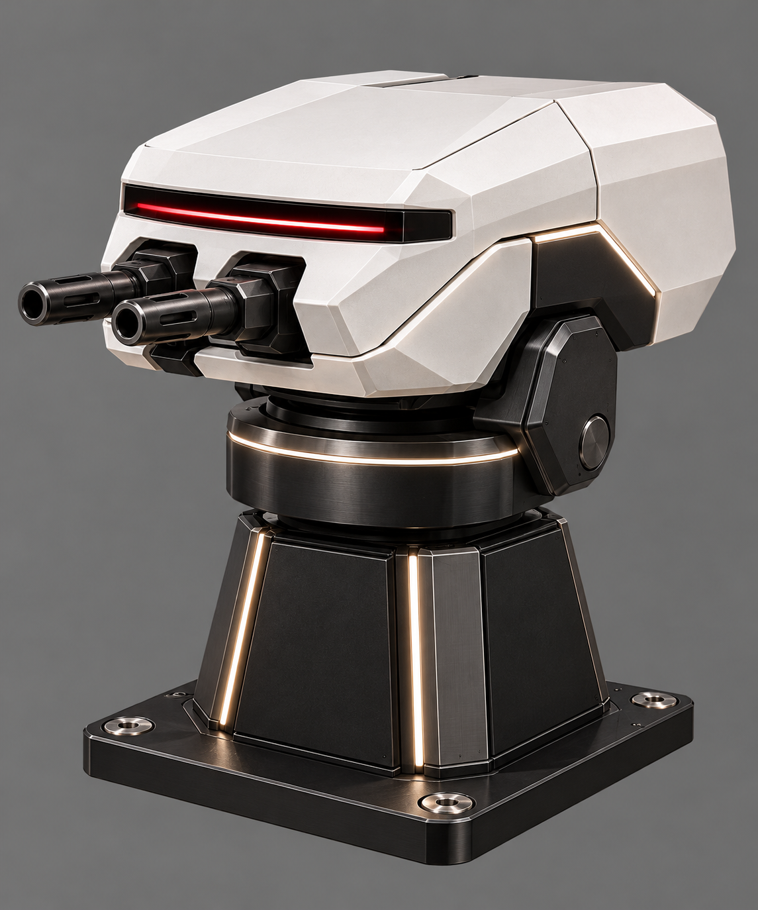
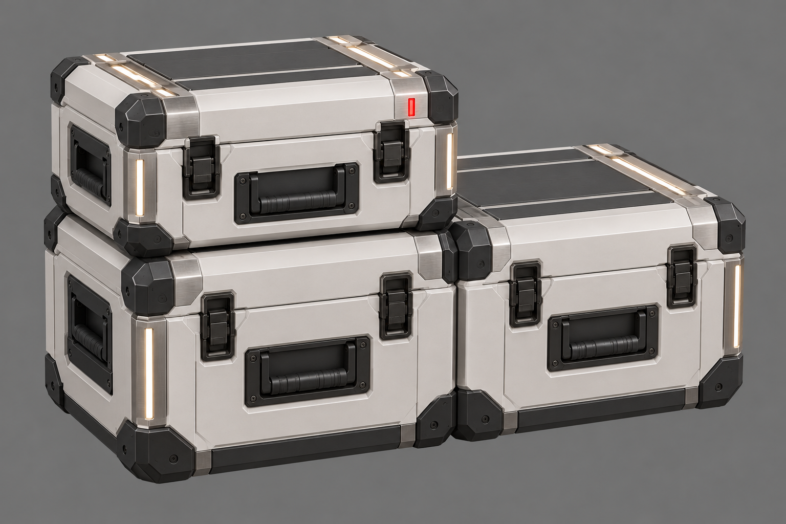
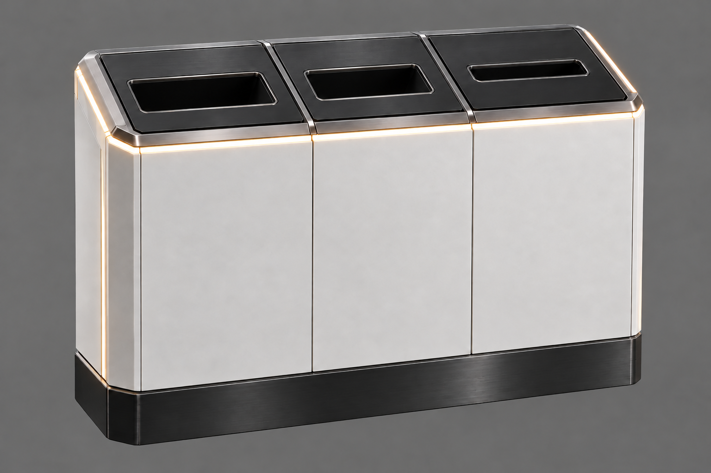
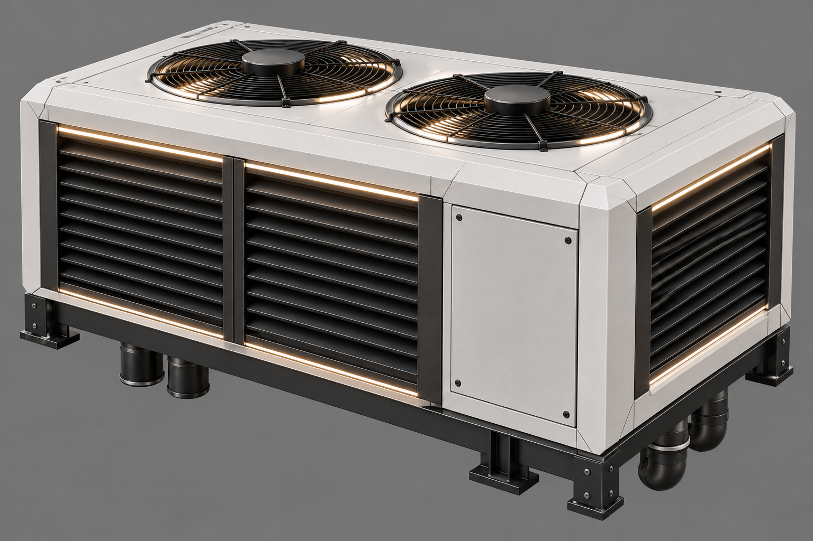
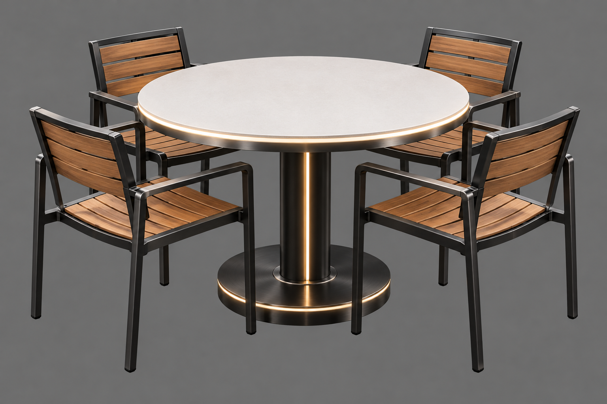

# Batch 4: image review

Generated 2026-10-11 by Astra, with the built-in image-generation tool, from [the batch 4 brief](../../briefs/batch-4.md) and [the proof-run style and framing](../../briefs/proof-run.md#what-every-image-needs-for-meshy).

Status: candidates for Bryson's review. No selection or final source delivery is recorded yet.

| Asset | Main view | Source destination after selection |
|---|---|---|
| Turret, revised | [01-turret-main.png](01-turret-main.png) | `art/sources/devices/turret/01-main.png` |
| Equipment cases | [02-equipment-cases-main.png](02-equipment-cases-main.png) | `art/sources/props/equipment_cases/01-main.png` |
| Waste and recycling station | [03-waste-station-main.png](03-waste-station-main.png) | `art/sources/props/waste_station/01-main.png` |
| Rooftop unit | [04-rooftop-unit-main.png](04-rooftop-unit-main.png) | `art/sources/props/rooftop_unit/01-main.png` |
| Terrace table set | [05-terrace-table-main.png](05-terrace-table-main.png) | `art/sources/props/terrace_table/01-main.png` |

## Reference and inspection notes

- [Terrace reference](../../reference/openbrain-research-park-terrace.png).
- Finished [bollard](../../sources/devices/bollard_light/01-main.png) and [access terminal](../../sources/devices/access_terminal/01-main.png) attached for shared material and finish quality.
- Each current candidate visually inspected: complete asset on a grey background, no floor or cast shadow, no text, with softly lit accents.
- Revised turret generated without attaching the camera head or rejected turret. Broad armored head, twin projecting barrels and sensor slit distinguish it from a camera.
- Equipment cases: three cases in a stepped stack. Terrace table: one table and four chairs form one grouped asset.
- Waste-station correction: replaced the initially round middle opening with a rectangular slot to match the brief.
- No lab robot arm: it was removed from this batch by Bryson.
- PNG headers and local review links checked. These images have not been converted to models or viewed in Godot.

## Review gallery

### Turret, revised

### Equipment cases

### Waste and recycling station

### Rooftop unit

### Terrace table set

