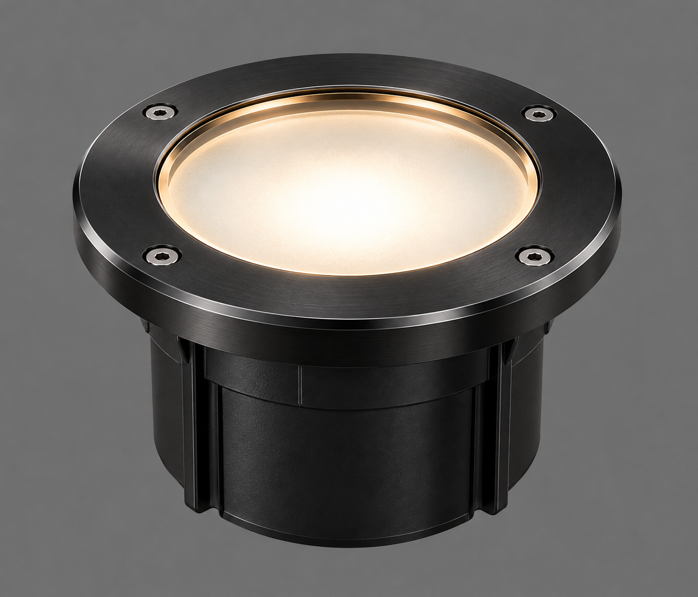
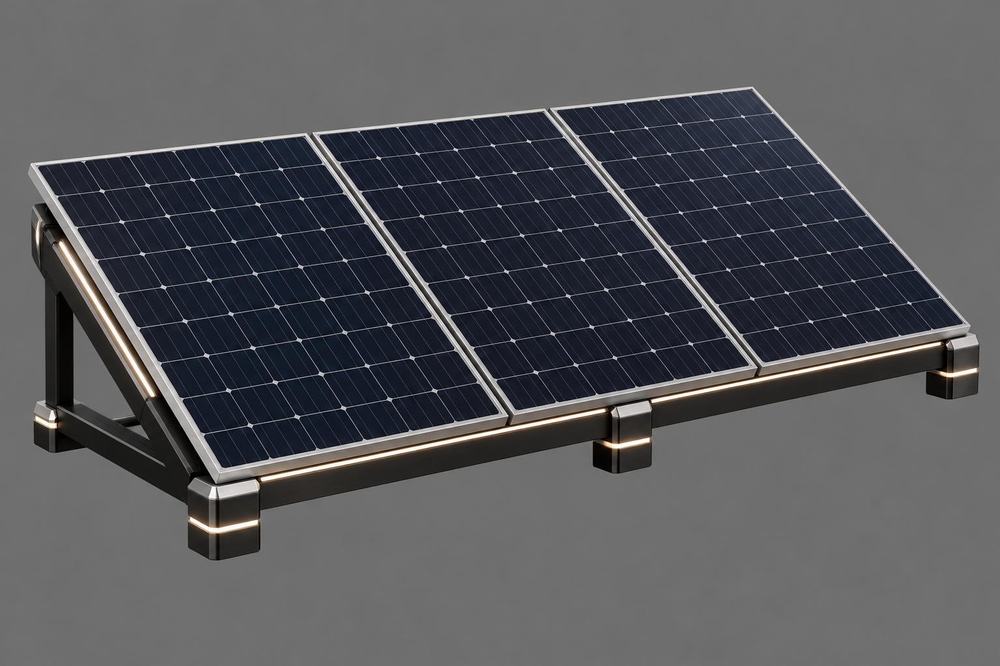
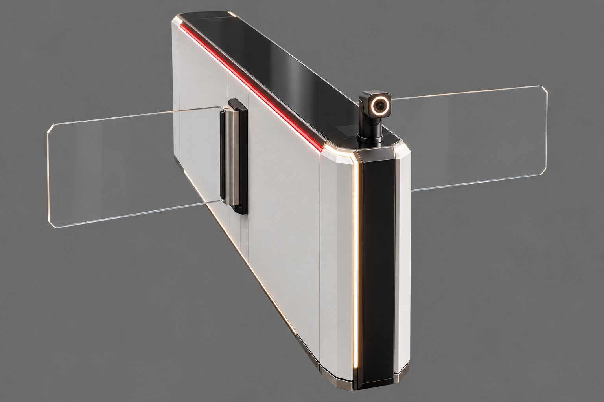
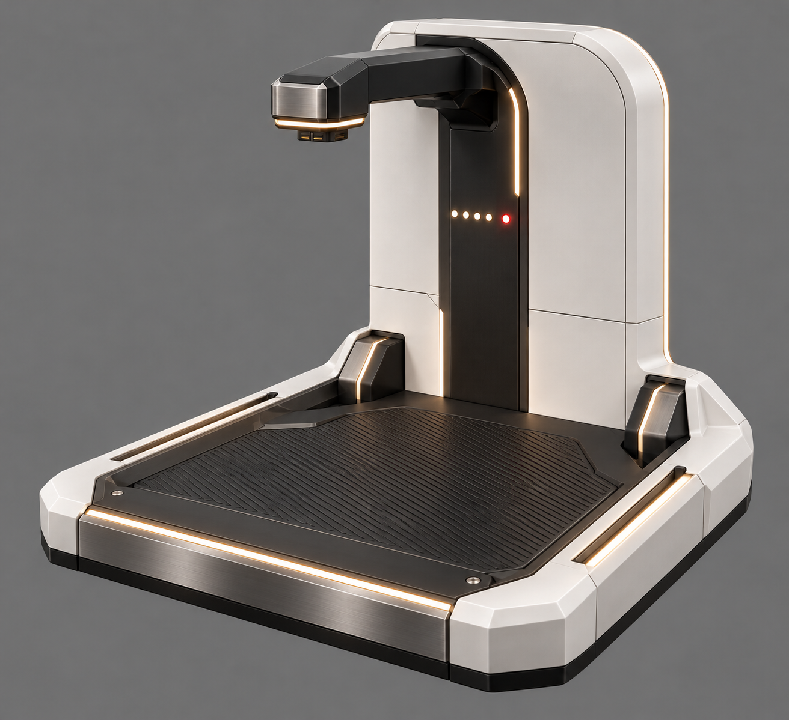

# Batch 5: image review

Generated 2026-10-11 by Astra, with the built-in image-generation tool, from [the batch 5 brief](../../briefs/batch-5.md) and [the proof-run style and framing](../../briefs/proof-run.md#what-every-image-needs-for-meshy).

Status: candidates for Bryson's review. No selection or final source delivery is recorded yet.

| Asset | Main view | Source destination after selection |
|---|---|---|
| Ground uplight | [01-uplight-main.png](01-uplight-main.png) | `art/sources/props/uplight/01-main.png` |
| Solar panel rack | [02-solar-rack-main.png](02-solar-rack-main.png) | `art/sources/props/solar_rack/01-main.png` |
| Security turnstile | [03-turnstile-main.png](03-turnstile-main.png) | `art/sources/props/turnstile/01-main.png` |
| Robot dog dock | [04-robot-dock-main.png](04-robot-dock-main.png) | `art/sources/props/robot_dock/01-main.png` |

## Reference and inspection notes

- Item-specific campus references from the brief: [terrace](../../reference/openbrain-research-park-terrace.png), [overhead](../../reference/openbrain-campus-overhead.png), [threshold](../../reference/openbrain-front-security-threshold.png), [river crossing](../../reference/openbrain-research-park-river-crossing.png).
- Finished [bollard](../../sources/devices/bollard_light/01-main.png) and [access terminal](../../sources/devices/access_terminal/01-main.png) attached for shared material and finish quality.
- Each current candidate visually inspected: complete asset on a grey background, no floor or cast shadow, no text, with softly lit accents.
- Solar rack: three panels on one frame. Robot dock: empty, with platform and charging arm visible.
- Turnstile corrected from an initial two-post gate to the brief's single long pedestal with two glass wings on opposite sides.
- PNG headers and local review links checked. These images have not been converted to models or viewed in Godot.

## Review gallery

### Ground uplight

### Solar panel rack

### Security turnstile

### Robot dog dock

