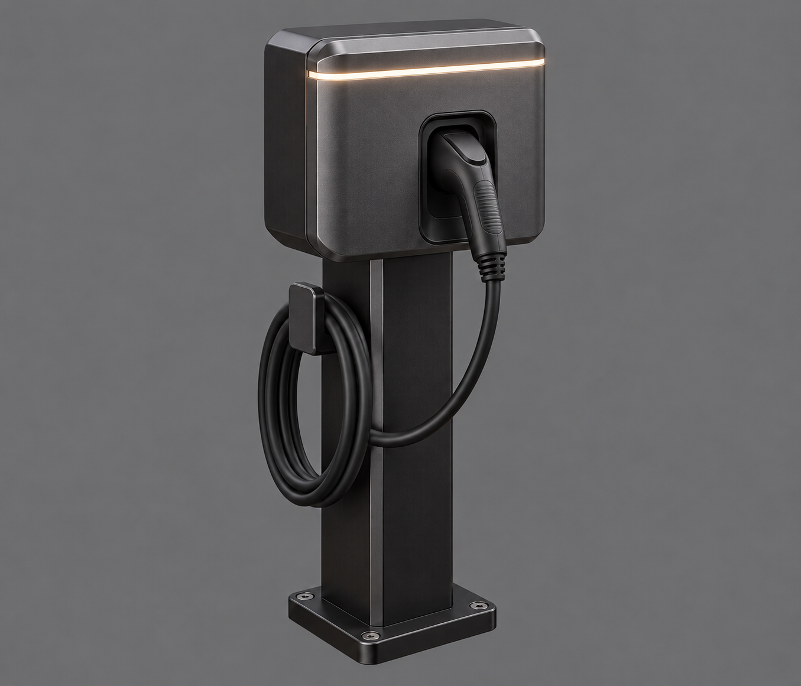

# Batch 6: revised EV charger review

Generated 2026-10-11 by Astra with the built-in image-generation tool, from [the batch 6 brief](../../briefs/batch-6-revisions.md) and [the proof-run style and framing](../../briefs/proof-run.md#what-every-image-needs-for-meshy).

Status: candidate for Bryson's review. Final source delivery follows his selection.

| Asset | Main view | Source destination after selection |
|---|---|---|
| EV charger, revised | [01-ev-charger-main.png](01-ev-charger-main.png) | `art/sources/props/ev_charger/01-main.png` |

## Reference and inspection notes

- Finished [bollard](../../sources/devices/bollard_light/01-main.png) and [fleet car](../../sources/devices/fleet_car/01-main.png) attached for material and finish quality only. Neither the access terminal nor the first charger was attached.
- Dark graphite charging box on a narrow black post, visible front-holstered connector and side cable loop, one thin warm status light. No screen, white panels or red accents.
- Visually inspected: whole asset, plain grey background, no floor or cast shadow, no text. PNG header and local links checked.
- Image only; no model generation or Godot inspection performed by Astra.

## Review image

