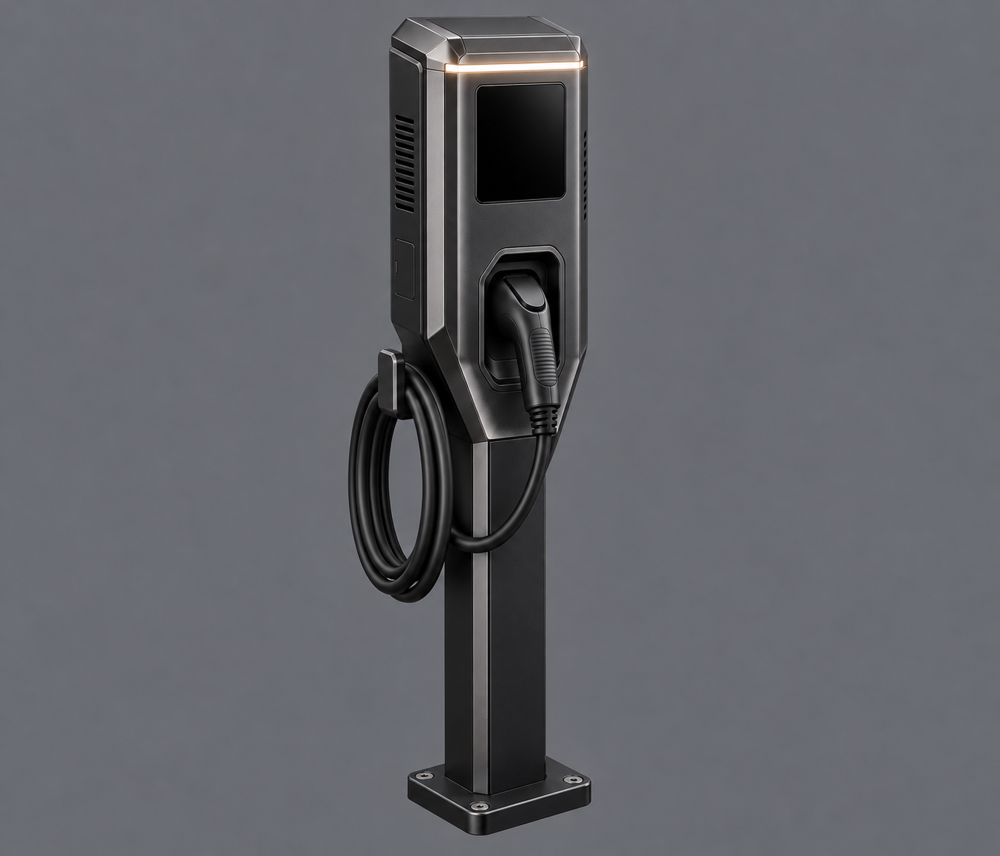

# Batch 6: revised EV charger review

Generated 2026-10-11 by Astra with the built-in image-generation tool, from [the batch 6 brief](../../briefs/batch-6-revisions.md) and [the proof-run style and framing](../../briefs/proof-run.md#what-every-image-needs-for-meshy).

Status: candidate for Bryson's review. Final source delivery follows his selection.

| Asset | Main view | Source destination after selection |
|---|---|---|
| EV charger, revised (current v3) | [01-ev-charger-main-v3.png](01-ev-charger-main-v3.png) | `art/sources/props/ev_charger/01-main.png` |

## Reference and inspection notes

- Finished [bollard](../../sources/devices/bollard_light/01-main.png) and [fleet car](../../sources/devices/fleet_car/01-main.png) attached for material and finish quality only. Neither the access terminal nor the first charger was attached.
- Bryson's revision direction, 2026-10-11: a slicker, more intricate and unique box, cohesive with the other objects, with a place for a screen. This supersedes the brief's no-screen requirement.
- Bryson's next revision direction, 2026-10-11: taller, on a pole, one body, with an intricate design. V3 targets about 1.6 m overall height with one elongated housing integrating screen and connector, mounted on a narrow pole; this supersedes the brief's original 1.1 m target.
- Current v3: tall graphite housing with sculpted chamfers and tapered lower neck, inset perimeter trim, side cooling slots and service hatch. Blank screen above the front-holstered connector, side cable loop, one thin warm status line. No white panels or red accents.
- [First candidate](01-ev-charger-main.png) retained for comparison. V2 edited from it with the finished fleet car as the additional finish reference.
- [V2](01-ev-charger-main-v2.png) retained for comparison; V3 edited from V2.
- Visually inspected: whole asset, plain grey background, no floor or cast shadow, no text. PNG header and local links checked.
- Image only; no model generation or Godot inspection performed by Astra.

## Review image

