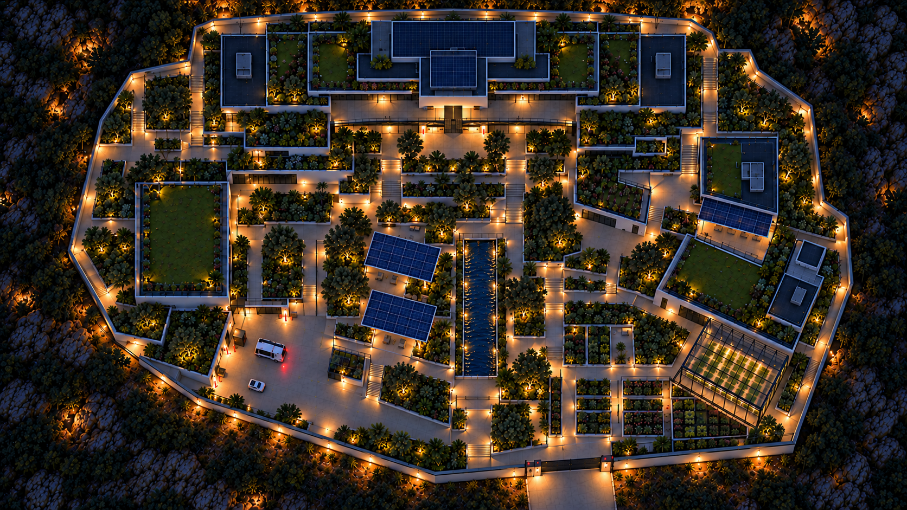
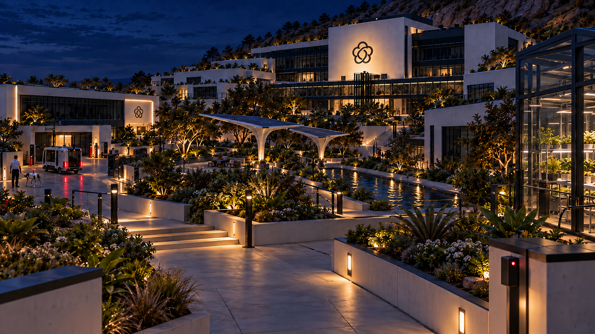
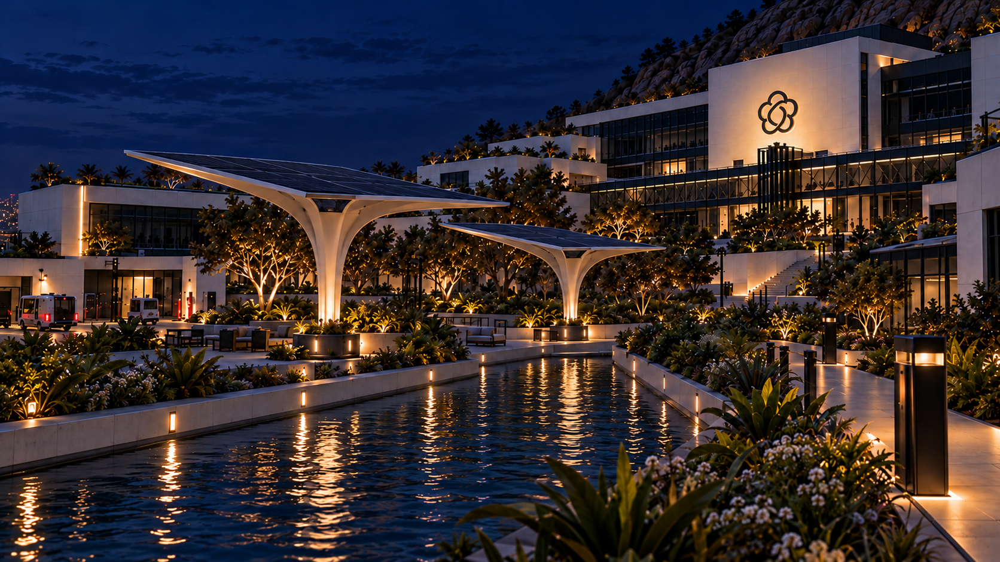
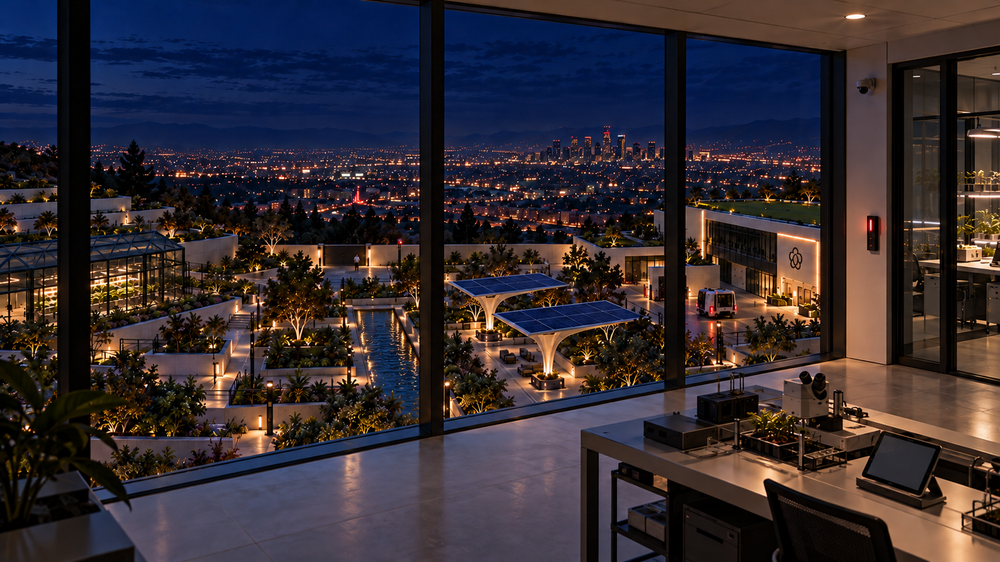

# OpenBrain mountainside campus: multiple-angle study

Four completed concept images from the same research park, generated October 10, 2026 with
the built-in image tool. The selected native PNGs below are saved at 1672 × 941 without
resampling, alongside exact prompts and provenance.

The [selected mountainside night overview](../rear-research-park-study-2026-10-10/01-rear-campus-overview-v3-hillside-night-robot-dogs.png)
is the architectural and layout anchor.

## Bryson's request and corrections

Bryson loves the mountainside night campus with robot dogs and asks for three finished views
from multiple angles, including inside, with consistent spatial relationships. During
generation he adds a view directly above to help establish the shared layout.

He then says the water is not apparent in the first images, and the aerial's ambient light
looks like dusk. The selected revisions emphasize the same basin's blue reflective water,
ripples and local lamp reflections in all four views. The aerial's unlit ground, roofs and rocky
surroundings are darker while the local warm lights remain luminous and details stay readable.

## Shared layout and cameras

North/uphill is a production convention for this study, inferred from the overview; it is
not a surveyed geographic bearing.

| Anchor | Shared relationship |
|---|---|
| Main headquarters and glazed gallery | Highest northern terrace, mountain behind |
| Western lab and autonomous-shuttle court | West of central garden |
| Water basin and two branching photovoltaic canopies | Basin in center; both canopies on its west bank |
| Greenhouse and instrumented planting | East/southeast of central garden |
| Privacy wall and closed gate | Lower southern boundary; gate east of water axis |
| City | Downhill, outside the wall, spreading across the south/west valley |

| No. | Selected view | Camera / consistency check |
|---|---|---|
| 1 | [Inside gate, looking uphill](01-inside-gate-looking-uphill-v2-readable-water.png) | Main building ahead/uphill; western lab and shuttle left, greenhouse right; water east/right of canopies. |
| 2 | [Central water garden](02-central-water-garden-looking-northwest-v2-readable-water.png) | East bank looking northwest; canopies across the water to west, main building higher/right. |
| 3 | [Upper gallery interior](03-upper-gallery-interior-looking-downhill-v2-readable-water.png) | Inside headquarters looking south/downhill; greenhouse outdoors left, lab/shuttle right, canopies west/right of water. |
| 4 | [Overhead roof/ground layout](04-direct-overhead-campus-layout-v2-water-and-night.png) | Uphill at top; west lab left, greenhouse lower right, canopies left of water, lower gate right of water axis. |

The [spatial plan](spatial-plan.md) records these shared anchors and direction changes.
Perspective views were generated sequentially, with completed earlier views supplied alongside
the overview. The overhead was built from those references and its projection was refined.
Targeted water edits retained each view's camera and landmark relationships.

## Review and limits

Agent visual review compared landmark side/order, terrace elevation, viewing direction,
white/black/red materials, nighttime exposure, water visibility, green roofs and mechanical
patrol dogs. The final images retain the same major layout relationships. The gallery view's
screen sides reverse because its camera faces downhill.

This is visual concept consistency rather than a reconstructed 3D site. Small dimensions,
individual path junctions, basin proportions, foliage and devices can vary. The overhead shows
roof/ground layout with some shallow relief; it is not a metrically exact orthophoto. No
modeled map, gameplay visibility or pathfinding was implemented or tested. Final selection
remains with Bryson.

[final-view-record.json](final-view-record.json) contains the four selected outputs, exact
correction prompts, ordered references, source paths, dimensions and hashes.
[generation-record.json](generation-record.json) retains the initial view prompts and overhead
projection history. Earlier source images remain alongside the selected revisions for
provenance; the four views listed above are this delivery.

## Selected images

### 4. Overhead layout

### 1. Inside gate, looking uphill

### 2. Central water garden

### 3. Upper gallery interior

