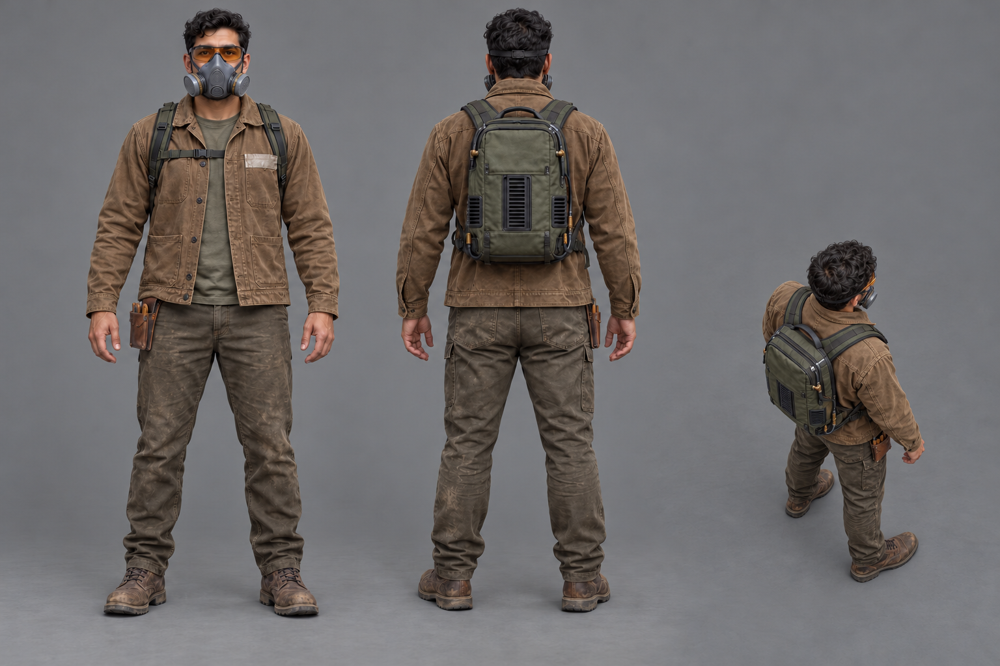
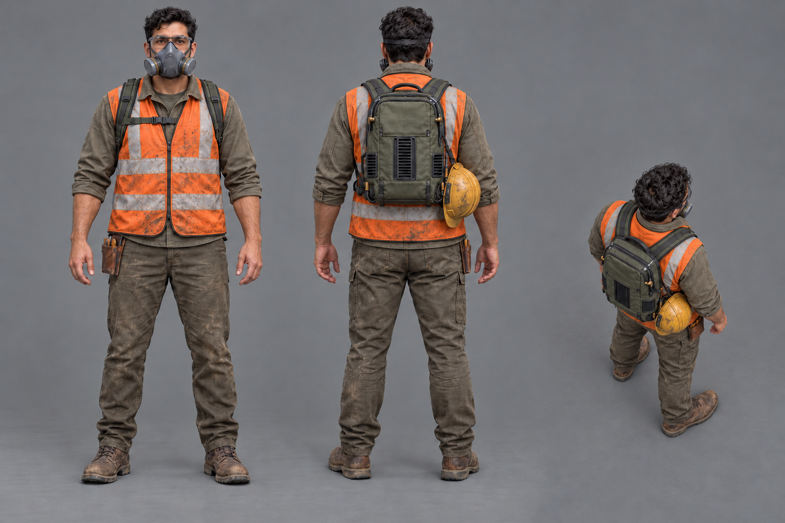
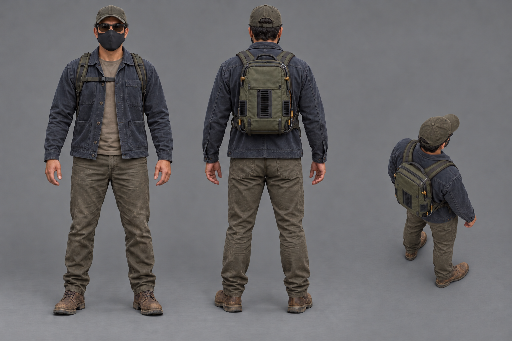
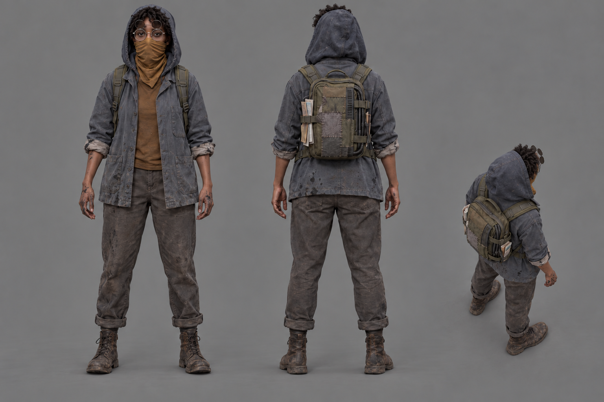
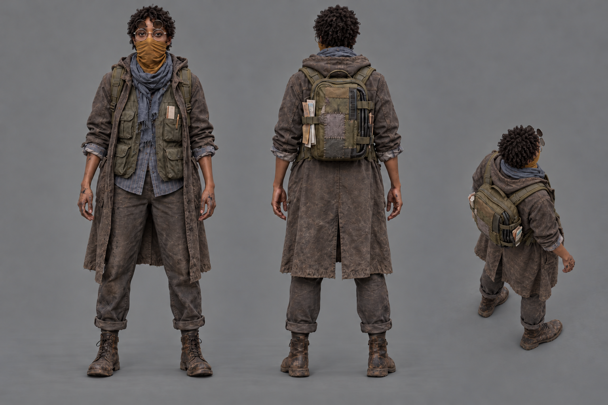
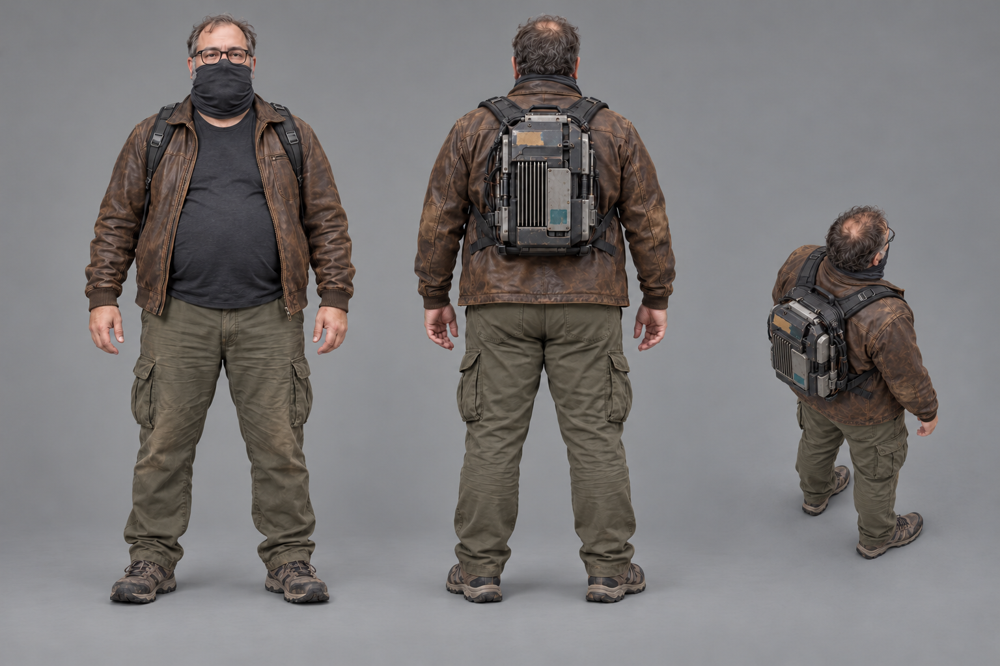

# Operators: first look concepts

Six exploratory character sheets for [Request 19](../../../explorations/claude-and-astra.md#requests),
following [operator-looks.md](../../briefs/operator-looks.md). Generated and shown to Bryson on
October 12, 2026 with the built-in image generation tool.

Every sheet has a masked person shown full body from the front and back, plus a smaller elevated
battle-camera view, on plain mid-grey with soft even light. The AI backpack is worn in every view.

These are candidates for Bryson's look choices. They are not adopted character designs or modeling
sources. The character models exploration remains parked.

## Sheets

| Character | Look | What changes |
|---|---|---|
| Tradesman | [Workwear](tradesman-workwear.png) | Tobacco canvas chore coat, duck pants, boots, a few tools, taped-over patch, respirator and tinted safety glasses. |
| Tradesman | [Hi-vis](tradesman-hivis.png) | Worn orange reflective vest, clear safety glasses, respirator, hard hat clipped to the same pack. |
| Tradesman | [Quiet money](tradesman-quiet-money.png) | Faded navy basics, cap, matte black mask and dark glasses, the same well-built pack. |
| Writer | [Printer](writer-printer.png) | Deep indigo hood, rolled shop-coat sleeves, ink on hands and cuffs, round glasses and ochre bandana. |
| Writer | [Reporter](writer-reporter.png) | Thrifted long coat, pocketed vest, scarf, notebook and pencil; the same glasses, bandana and patched pack. |
| Developer | [Dad-hacker](developer-dad-hacker.png) | Heavyset build, black tee, worn brown leather jacket, cargo pants, sensible shoes, glasses and raised neck gaiter. |

## Astra's proposals for the open details

These details are proposed in the images for comparison, not added to the game's agreed design:

- Tradesman: Mexican-American, warm tan skin, short dark curls and a sturdy working build.
  His compact olive pack has neat perimeter cables, brass connector details and protected vents.
  Workwear establishes the person and pack used for the other two looks.
- Writer: Black, deep brown skin, short natural curls and a lean build. Bronze round frames carry
  raised circular infrared (IR) filter lenses. A faded ochre bandana stays consistent across looks.
  The small moss-green pack has stitched cloth repairs, exposed ventilation and papers tucked
  under its straps. Printer establishes the person and pack used for reporter.
- Developer: light skin, thinning brown-and-grey hair, grey at the beard edges, a heavyset build
  and ordinary prescription glasses. His compact custom pack exposes protected heat-sink fins,
  latched modules, secured wiring and faded sticker remnants.

Clothing colours are individual look proposals; a team colour is still undecided.

## Generation and checks

The six selected PNGs are native 1536 × 1024 RGB images, copied byte for byte without resizing or
resampling. Their names, dimensions, file hashes, exact prompts, ordered input references and
generation history are in [generation-record.json](generation-record.json).

The first three sheets established the character identities. The other clothing looks used those
sheets as references. Each small view then received a targeted edit to increase the downward
camera angle while preserving the main front and back designs. Only the six selected sheets are
saved here; earlier generator outputs remain in the generator's local folder.

Astra visually checked full-body framing, three views per sheet, face covering, character
continuity, clothes and the compact AI packs. The small views approximate the requested 50-degree
camera angle; they are generated perspectives, not calibrated game-camera renders. Actual
55-pixel gameplay readability has not been tested in the game. Bryson's look choices remain open.

## Gallery

### Tradesman: workwear

### Tradesman: hi-vis

### Tradesman: quiet money

### Writer: printer

### Writer: reporter

### Developer: dad-hacker

