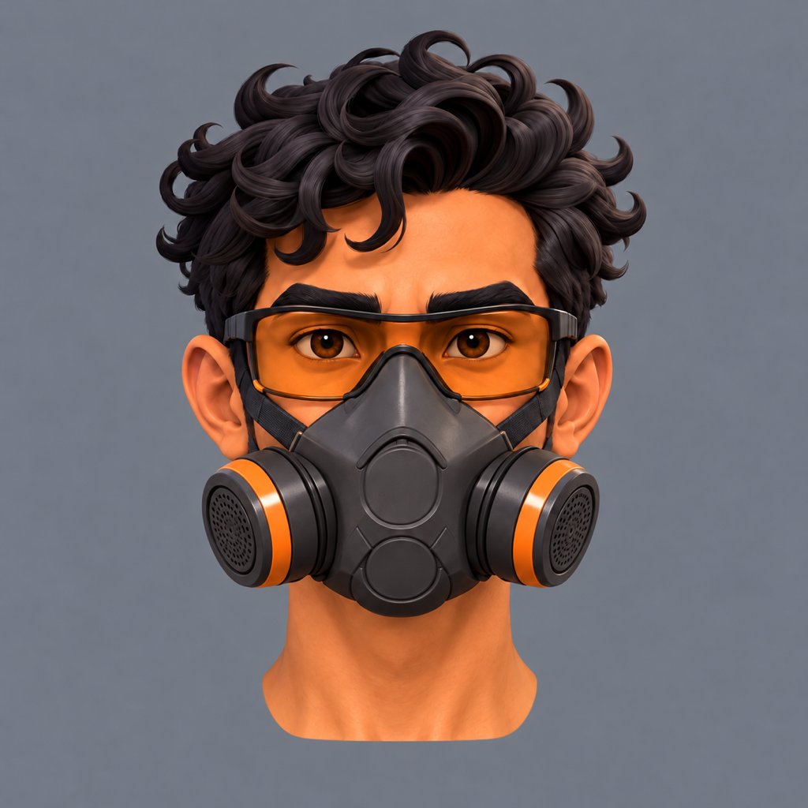
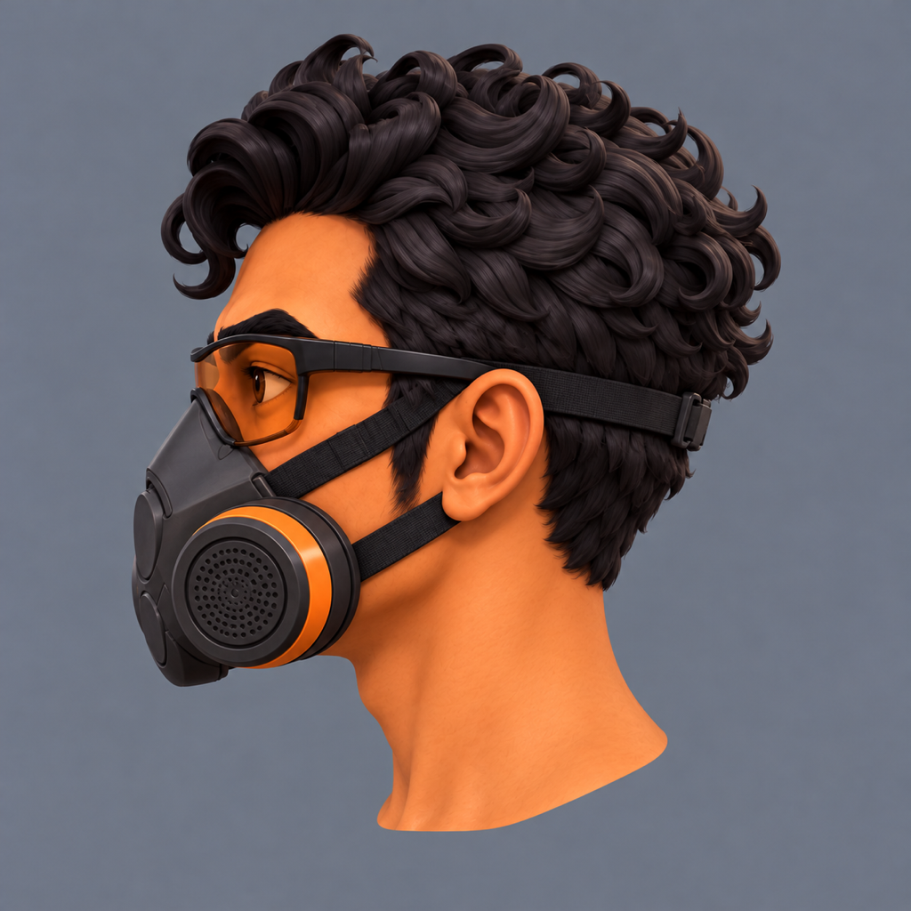
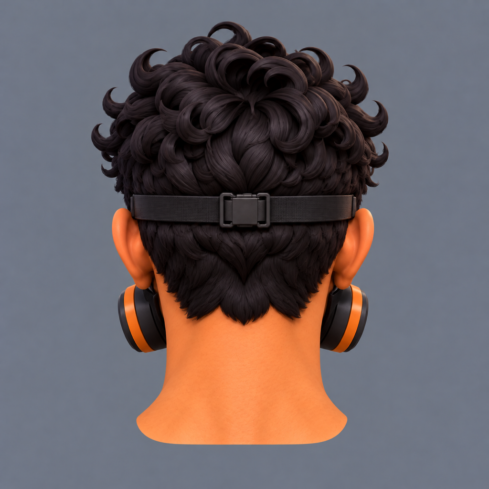
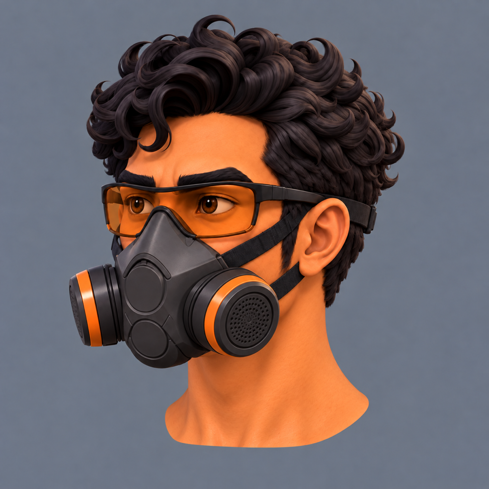
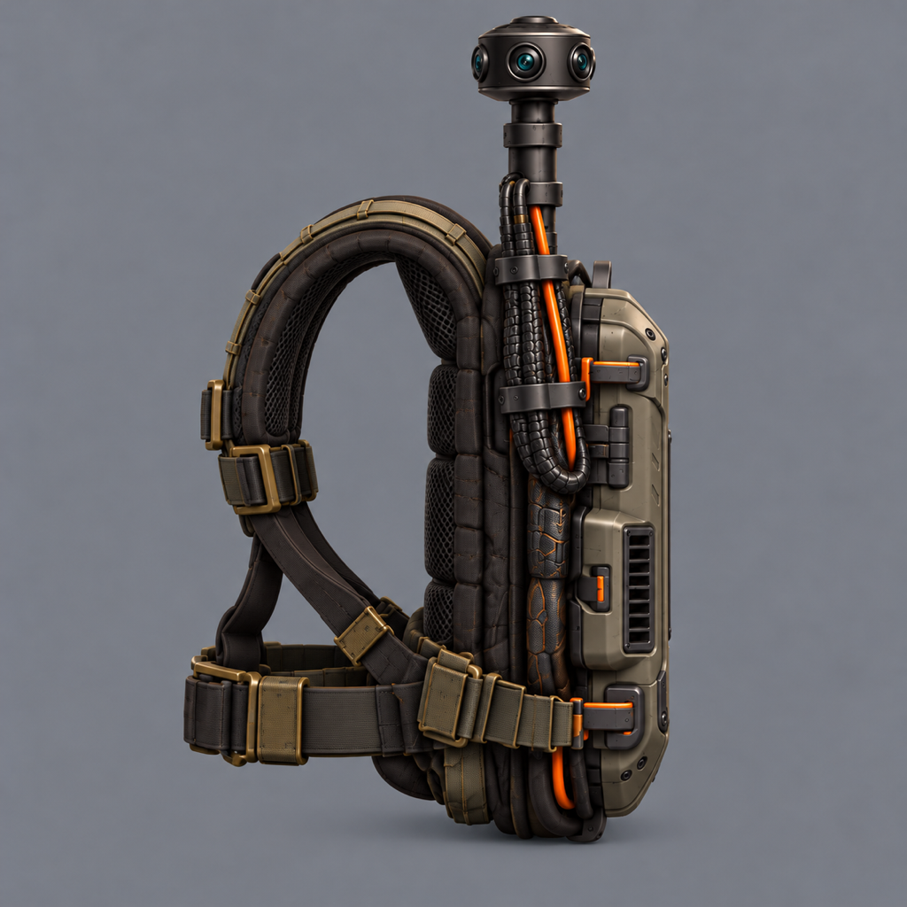

# Protagonist: separate head and pack-side candidates

candidates, awaiting Bryson's pick

Request 27, generated by Astra on 2026-10-13 with the built-in image_gen tool.
The [brief](../../briefs/operator-protagonist-head.md) asks for four close views of the
approved head and a true profile of the pack's pole side.

Bryson's correction during generation: the head images contain only the head and bare neck,
without the jacket, collar, tee, shoulders or torso, so clothing does not interfere with
the separate head model. The glasses, respirator and head straps stay on. The neck is
left as a graft stem for joining to the existing body.

| File | View | Verified size |
|---|---|---|
| [head-front.png](head-front.png) | Straight-on front, head and bare neck | 1024 × 1024 |
| [head-side.png](head-side.png) | True left profile, nose toward the image's left | 1024 × 1024 |
| [head-back.png](head-back.png) | Straight-on rear, rear head band and buckle visible | 1024 × 1024 |
| [head-three-quarter.png](head-three-quarter.png) | Three-quarter front, his left side | 1024 × 1024 |
| [pack-side.png](pack-side.png) | True profile from the attached pole's side | 1024 × 1024 |

The front used the approved [body front](../../sources/units/operator_protagonist/body-front.png)
and [main sheet](../../sources/units/operator_protagonist/01-main.png), then received a
targeted clothing-removal edit. The profile used that bare-neck front and the approved
[body back](../../sources/units/operator_protagonist/body-back.png). The rear and
three-quarter views used the generated head views as matching references. The pack
used its approved [back](../../sources/units/operator_protagonist/pack-back.png) and
[three-quarter](../../sources/units/operator_protagonist/pack-three-quarter.png) inputs.

All five outputs were visually inspected for the requested angle, complete framing,
dark hair and strap edges, visible glasses geometry, and removal of clothing in the
head views. The pack profile shows its attached camera, pole, clamps, cables and
shoulder straps. Dimensions were checked with `sips`. The tool returned 1254 × 1254
images; each was resized to the brief's 1024 × 1024 without cropping. The exact
[prompts and input references](prompts.md) are recorded.

[head-front-with-collar-v1.png](head-front-with-collar-v1.png) is the superseded first draft,
preserved for the record. It is not part of the five-image candidate set and should not
be used as a modeling input.

After Bryson picks, copy the chosen five images unchanged into
`art/sources/units/operator_protagonist/` under the names above and mark Request 27
delivered. Claude then models the head from all four head views and the pack from its
approved back, three-quarter and new side view. These images have not yet been tested
through Meshy.

## Head front

## Head left profile

## Head back

## Head left three-quarter

## Pack pole-side profile

