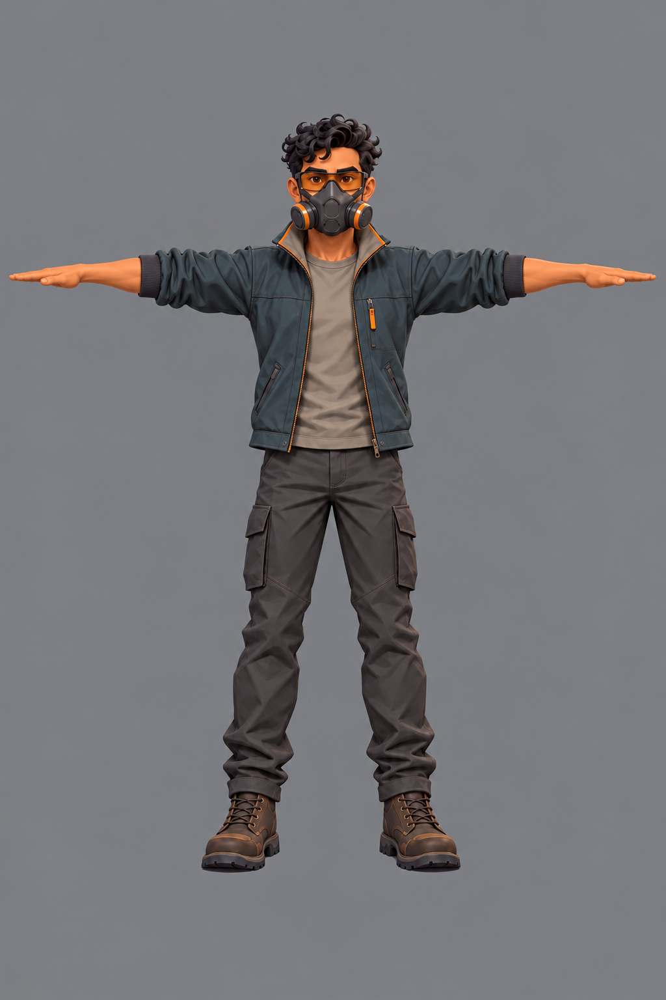
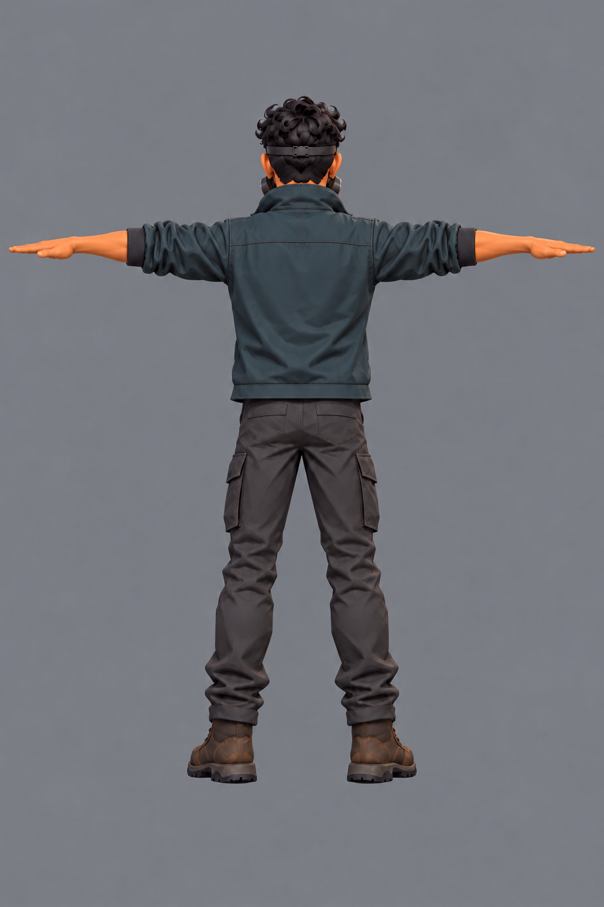
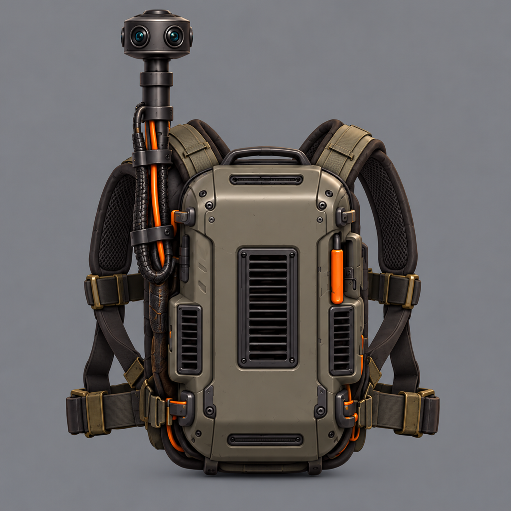
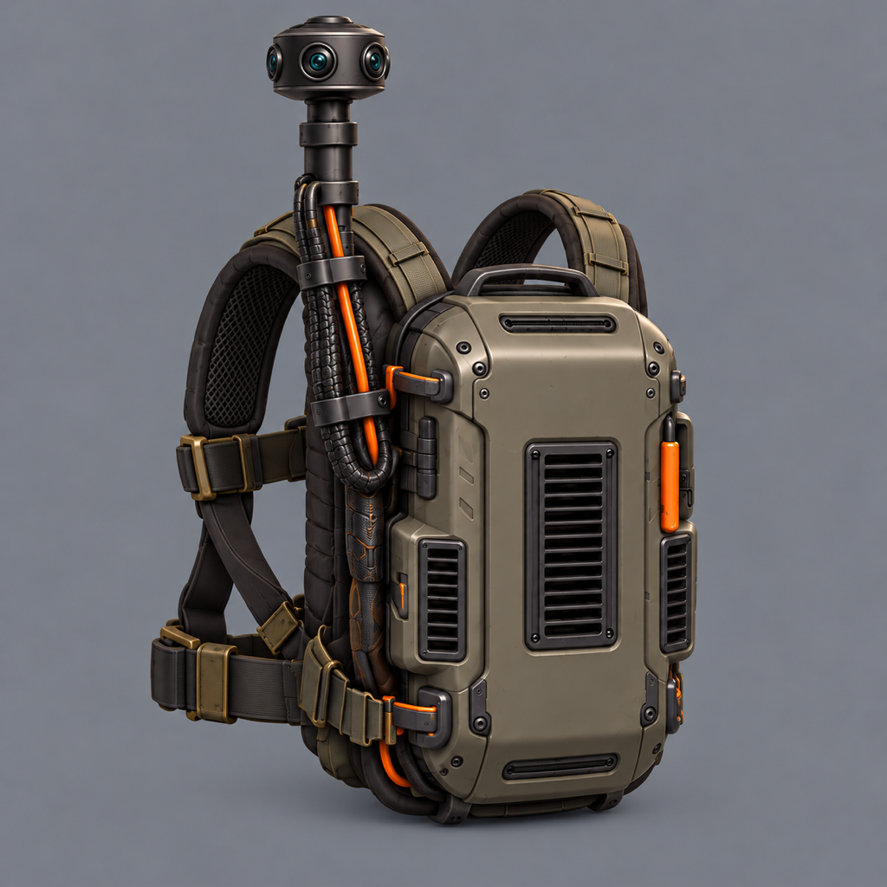

# Protagonist: separate Meshy input candidates

candidates, awaiting Bryson's pick

Request 25, generated by Astra on 2026-10-13 with the built-in image_gen tool. The
[brief](../../briefs/operator-meshy-inputs.md) asks for the approved protagonist and pack as
four separate inputs, with no design changes. The body reference is
[his approved sheet](../../sources/units/operator_protagonist/01-main.png); the pack reference
is the left column of the [approved lineup](../operator-revision-2026-10-13/packs.png).

| File | View | Verified size |
|---|---|---|
| [body-front.png](body-front.png) | Straight-on front, T-pose, without pack or its straps | 1024 × 1536 |
| [body-back.png](body-back.png) | Straight-on back, T-pose, plain jacket back | 1024 × 1536 |
| [pack-back.png](pack-back.png) | Pack alone, straight-on back, complete camera pole on viewer's left | 1024 × 1024 |
| [pack-three-quarter.png](pack-three-quarter.png) | The same pack and pole, three-quarter rear | 1024 × 1024 |

The back body used the generated front and approved sheet as references. The three-quarter
pack used the generated pack back and approved lineup. All four were visually inspected for
complete framing, the requested pose/view, and removal or retention of equipment as required.
Dimensions were checked with `sips`. The tool produced 1254 × 1254 pack images; those were
resized without cropping to the brief's 1024 × 1024. Body files retain their generated pixels.
The exact prompt set is recorded in [prompts.md](prompts.md).

These are review candidates, not approved modeling sources. No file in `art/sources/` was
replaced, and Meshy modeling has not been run. Once Bryson picks, copy the chosen images
unchanged into `art/sources/units/operator_protagonist/` and name those files in Request 25.

## Existing Request 22 crop faults

As identified in the brief, the protagonist's existing `02-pack-back.png` contains a cut-off
writer pack, and `03-pack-three-quarter.png` contains the whole lineup. These new pack
candidates are their proposed replacements after selection. The writer's and developer's
three-quarter crops cut off the camera head; their four pack images wait for their own Meshy
input requests. This batch does not replace those sources.

## Body front

## Body back

## Pack back

## Pack three-quarter

