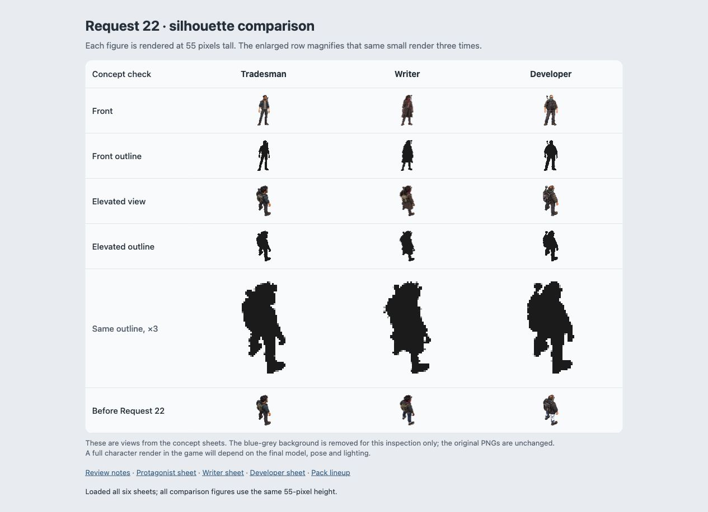
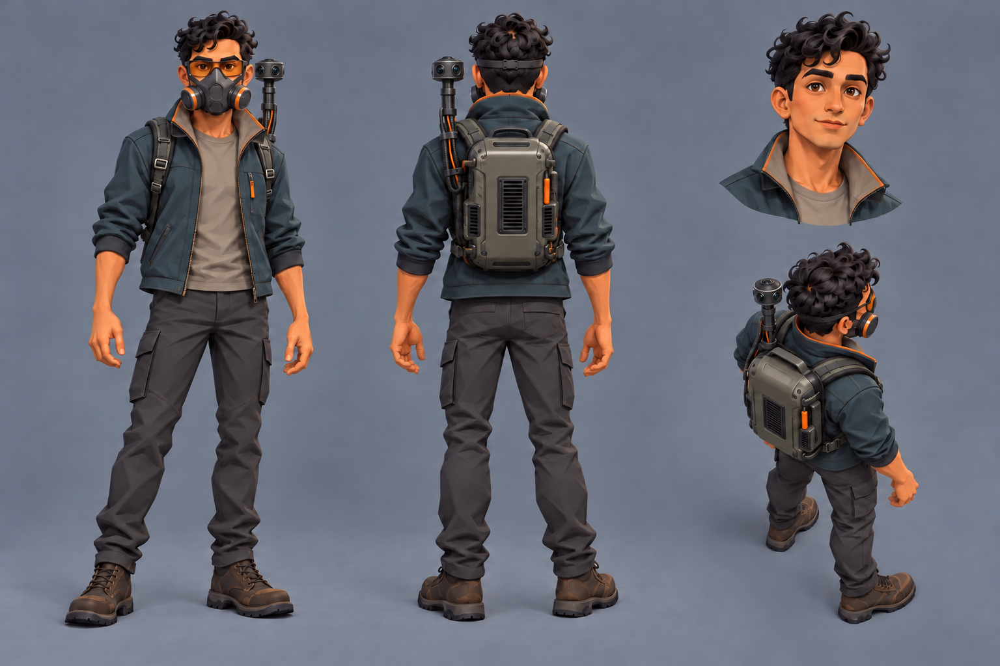
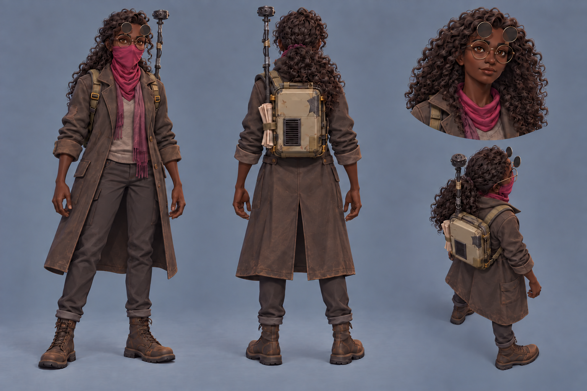
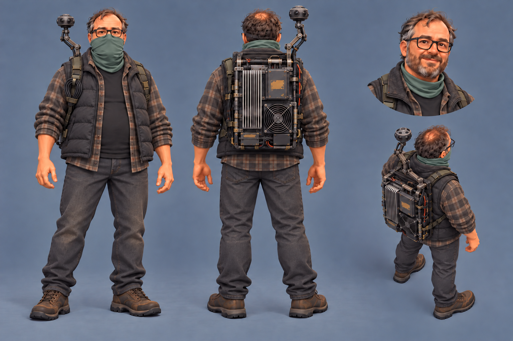
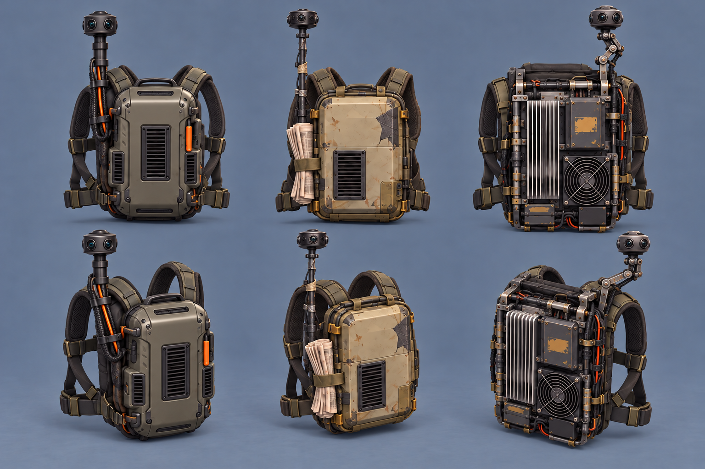

# Operators revised: personality and wearable computers

candidates, awaiting Bryson's pick

Four exploratory images for [Request 22](../../../explorations/claude-and-astra.md#requests),
following [operator-revision.md](../../briefs/operator-revision.md), generated with the built-in
image generation tool on October 13, 2026. The approved outfit directions and pack pairing in
the brief guide these candidates; approval of the actual images remains with Bryson.

The adopted [protagonist sheet](../../reference/operator-protagonist-style.png) controls the
rendering, lighting, proportions, blue-grey background and four-view layout: masked front and
back full body, unmasked portrait at upper right, elevated rear view at lower right.

| Image | Outfit and identity | Wearable computer |
|---|---|---|
| [protagonist.png](protagonist.png) | His adopted face, jacket, cargo pants, boots, glasses and respirator retained. | Newer compact moulded industrial case, integrated vents and tidy cables; a sturdy straight camera mast. |
| [writer.png](writer.png) | Photo-inspired feminine face, deep brown complexion and long curls; tied back in the body views, loose in the portrait. Worn long coat, scarf, thrifted layers, slim trousers and boots; round glasses with raised infrared filters and magenta bandana retained. | Old yellowed plastic consumer case with scuffs, a taped crack and folded paper under a strap; a thin taped camera stalk. |
| [developer.png](developer.png) | His heavyset build and friendly face retained. Padded vest over muted flannel, worn work pants and trail shoes; the green gaiter remains muted. | Exposed homemade server frame with cooling fan, heat-sink fins, latches and hand-routed cables; a hinged camera arm. |
| [packs.png](packs.png) | Hardware only, without people. Left to right: protagonist, writer, developer; back views above, three-quarter views below. | The three revised sheets were the input references. Each unit has its own raised 360-degree camera. |

## Inputs and generation

Bryson's attachments are preserved under [inputs/](inputs/). The fashion photo controls the
writer's face and longer curls only. Her clothing follows the approved long-coat brief.
The first writer pass was corrected for the brief's deep brown complexion. The front views were
then corrected so their camera mounting sides agree with the back views. Intermediate generator
paths and the exact inputs used before filenames were updated are recorded; the corrected
sheets are the candidates saved here.

All four sheets are native **1536 × 1024** RGB PNGs. Copies were verified byte for byte against
the generator outputs, without resizing or resampling. Exact prompts, ordered input paths,
selected generator outputs, dimensions and SHA-256 file hashes are in
[generation-record.json](generation-record.json). Here, `selected` identifies the saved output
of a generation call; it does not record Bryson's approval.

## Silhouette check

[readability.html](readability.html) shows the front and elevated views side by side at
**55 pixels per figure**, in colour and as dark outlines, alongside the previous elevated views.
The enlarged outline row magnifies the same small render three times. The comparison removes the
edge-connected blue-grey background for inspection; the source PNGs remain unchanged.

Astra's observation: the writer separates most clearly through her long coat and longer hair.
The protagonist is narrower, with a short jacket, while the developer has a broad torso and
bulkier rig. Their front outlines are distinct; from above the two men remain closer to one
another than either is to the writer. The camera stems are visible at this size, but their
mechanical details disappear. This is a comparison of concept sheets, not a game-camera render
or proof of readability for finished models, animation and scene lighting.

## Protagonist

## Writer

## Developer

## The computers

