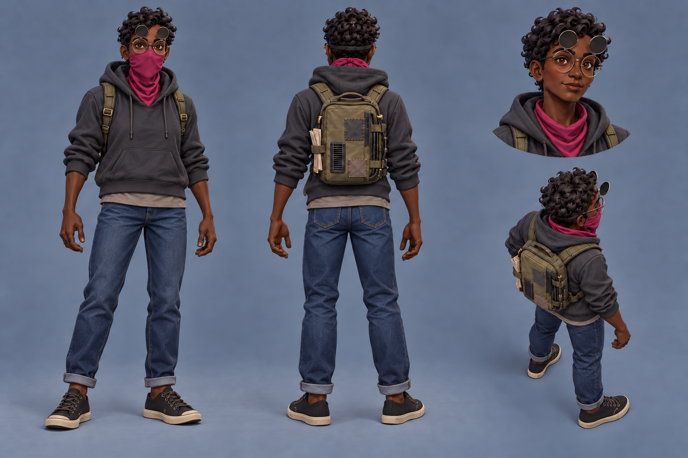
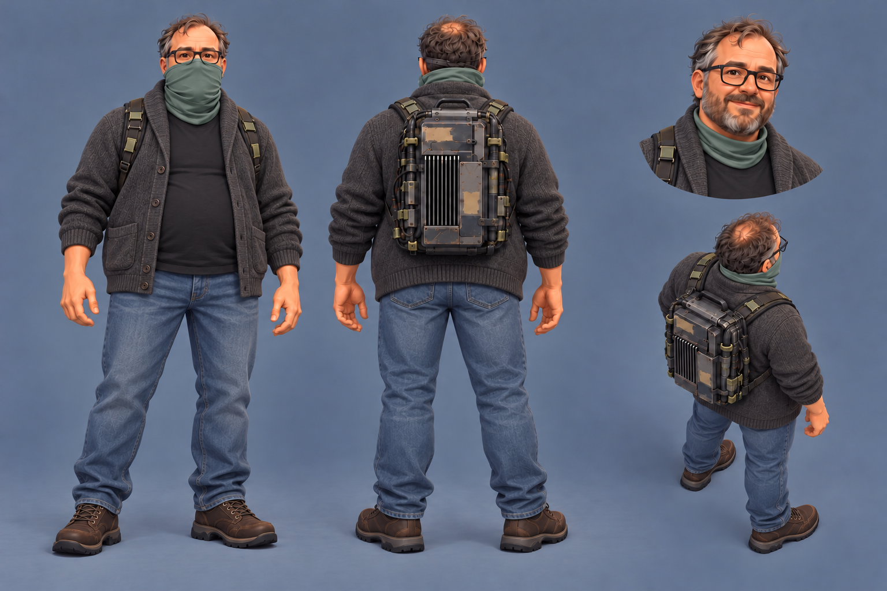

# Writer and developer sheets

Two exploratory sheets for [Request 21](../../../explorations/claude-and-astra.md#requests),
following [operator-sheets.md](../../briefs/operator-sheets.md) and Bryson's streetwear revision
on October 13, 2026. Generated with the built-in image generation tool and shown to Bryson.

The adopted [protagonist sheet](../../reference/operator-protagonist-style.png) controls the
rendering and layout: masked front and back full-body views, an unmasked portrait at top right,
and an elevated battle-camera view at bottom right, on blue-grey.

| Sheet | Current outfit candidate | Character details retained |
|---|---|---|
| [writer.png](writer.png) | Charcoal pullover hoodie over a longer grey tee, cuffed indigo jeans and black canvas sneakers. Magenta stays on the bandana. | Deep brown skin, short natural curls, round glasses with raised infrared filters, small ink smudges and a lighter patched computer pack with folded paper. |
| [developer.png](developer.png) | Open charcoal cardigan over a black tee, relaxed faded blue jeans and brown shoes. His gaiter is muted pine green; coloured strap tabs are removed. | Heavyset mid-40s man, friendly round face, thinning brown-and-grey hair, short beard, rectangular glasses and the overbuilt computer rig with latches and heat-sink fins. |

These outfit choices are proposals in the images, not adopted character designs or modeling
sources. The current sheets reflect Bryson's correction that they should wear individual
streetwear, with subtler green for the developer.

Both PNGs are native **1536 × 1024** RGB images, copied byte for byte without resizing or
resampling. The sheets were visually checked against the reference for style, layout, identity,
masks, portraits, accents and packs. Exact prompts, input references, intermediate generator
paths, selected files and SHA-256 hashes are in [generation-record.json](generation-record.json).
Earlier outfit and colour passes remain recorded there; only the current pair is saved here.

The elevated views approximate the reference camera angle. No models or in-game readability
checks were made. Bryson's review of these outfit candidates remains open.

## Writer

## Developer

