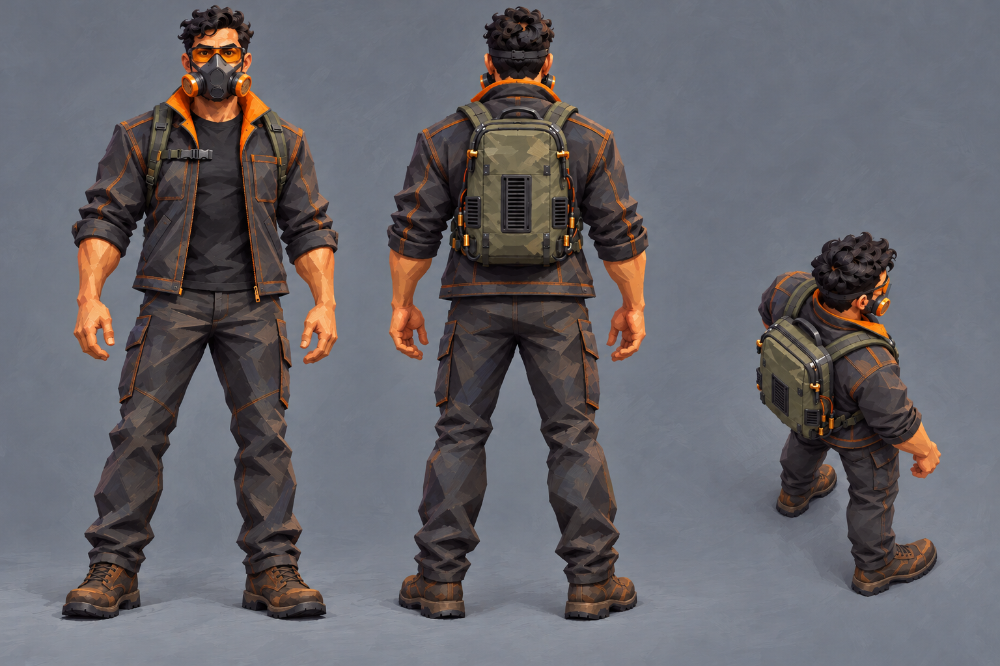
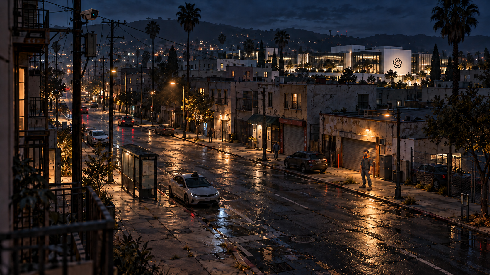
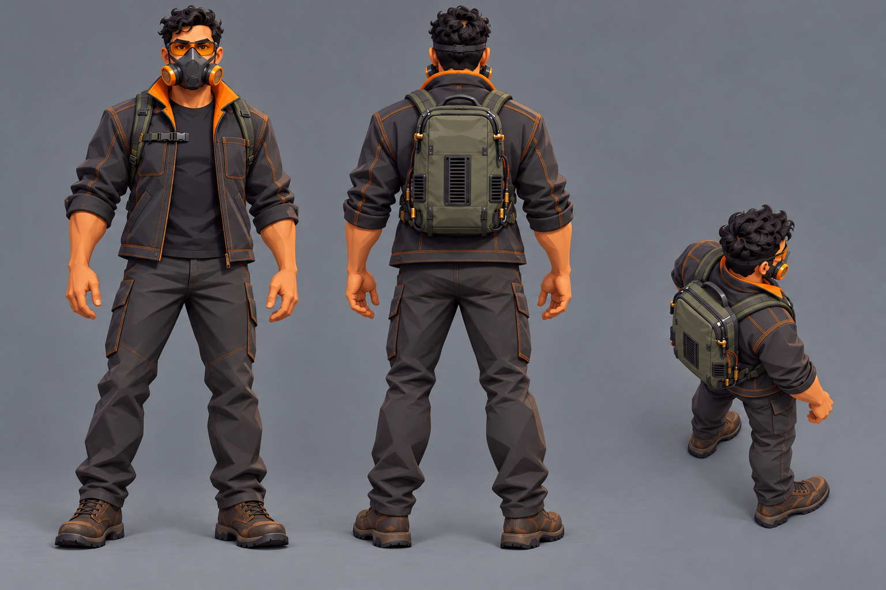
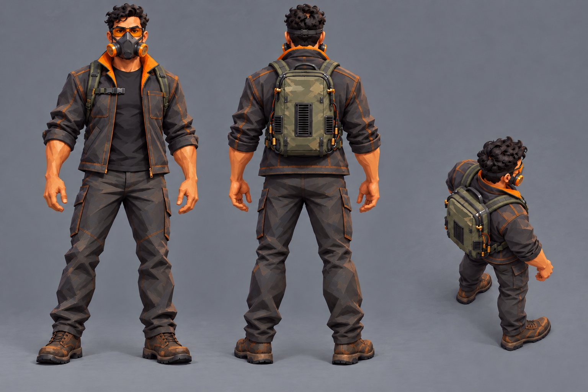
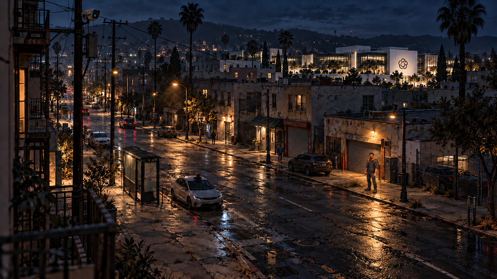

# Operators: style test

Six exploratory images for [Request 20](../../../explorations/claude-and-astra.md#requests),
following [operator-style-test.md](../../briefs/operator-style-test.md). Generated and shown to
Bryson on October 13, 2026 with the built-in image generation tool. The style choice remains
Bryson's; these are concept comparisons, not adopted designs or modeling sources.

The same protagonist wears the same outfit throughout: charcoal jacket with orange collar lining
and stitching, black tee, dark work pants, brown boots, orange-capped respirator, amber glasses,
and the compact vented computer backpack. The clean hero sheet established the outfit and
turnaround used by the other styles.

| Style | Character sheet | In the commercial street | Treatment |
|---|---|---|---|
| Painterly | [style-painterly.png](style-painterly.png) | [in-world-painterly.png](in-world-painterly.png) | Sculpted planes and visible authored brushwork, after Dishonored and Deathloop. |
| Clean hero | [style-clean-hero.png](style-clean-hero.png) | [in-world-clean-hero.png](in-world-clean-hero.png) | Crisp shapes, simplified materials and clear colour blocking, after Overwatch and Valorant. |
| Blend | [style-blend.png](style-blend.png) | [in-world-blend.png](in-world-blend.png) | Clean hero shapes with selective painterly surface texture. |

Every sheet shows full-body front and back views plus a smaller elevated battle-camera view on
mid-grey. The sheets are native **1536 × 1024** PNGs. The street images are native **1672 × 941**
PNGs, matching [the commercial street reference](../../reference/city-commercial-street.png).
The protagonist stands small on the right sidewalk under the warm streetlight, in approximately
the same position and pose in each street comparison.

All six were visually checked and copied byte for byte without resizing or resampling. Exact
prompts, ordered input references, selected outputs, dimensions and SHA-256 file hashes are in
[generation-record.json](generation-record.json). An initial overly realistic sheet and a street
edit that softened the background were replaced; their generator paths remain in that record.

The elevated views approximate the requested 50-degree angle. The street images retain the
reference composition and realistic setting, but image generation introduces small background
and edge differences; they are not pixel-identical composites. No models or game-camera renders
were made, and actual gameplay readability remains untested.

## Painterly

## Clean hero

## Blend

