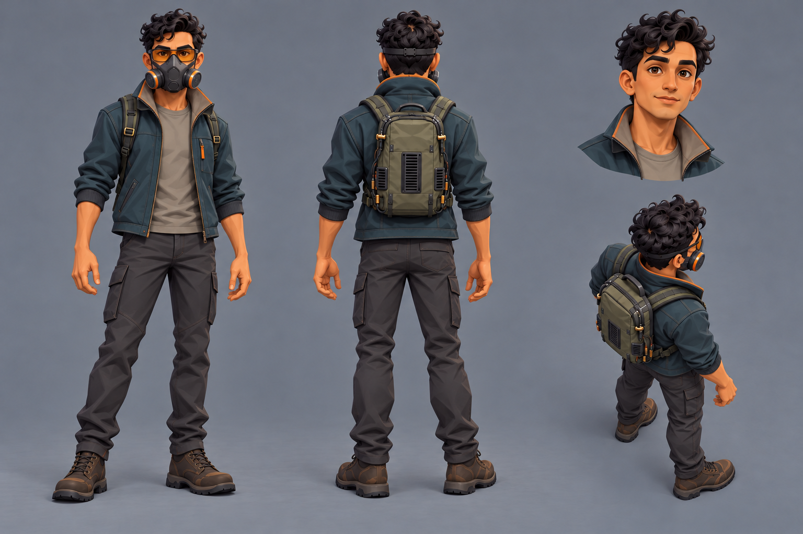

# Protagonist: adopted style sheet

delivered: `style-clean-hero.png` approved by Bryson as the character style reference

Bryson called this revised sheet "essentially perfect" on October 13, 2026. Claude copied it to
[art/reference/operator-protagonist-style.png](../../../reference/operator-protagonist-style.png)
for the later Operator sheets. Request 22 explicitly asks Astra to commit this previously
untracked original as well.

The two files were checked and are byte-for-byte identical. Their SHA-256 hash is
`75837aa5ef8c84367bf340b774b2dcf01bf211ce77b213b0f2871be887f4e9ed`.
This sheet is the approved rendering and layout reference for the characters. The revised
character and computer candidates from Request 22 have their own
[review gallery](../../operator-revision-2026-10-13/README.md).

