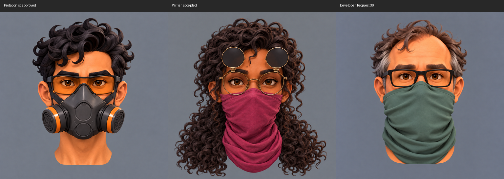
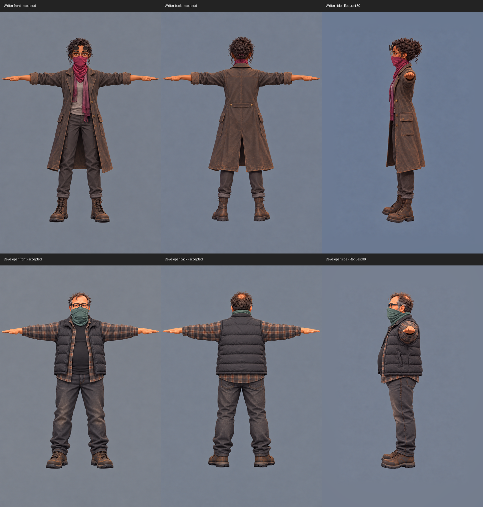
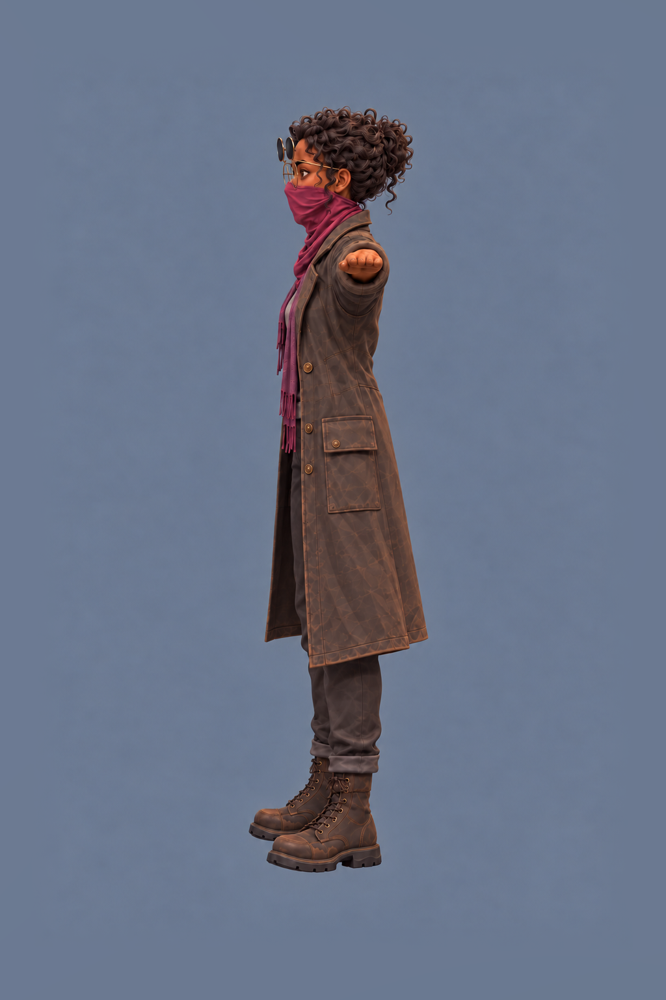
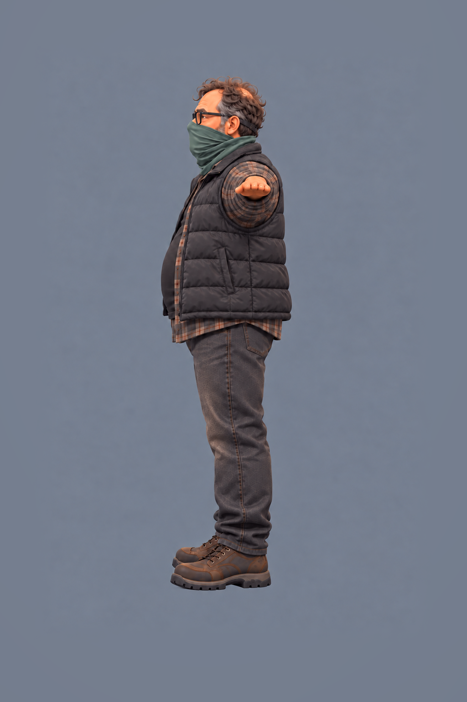
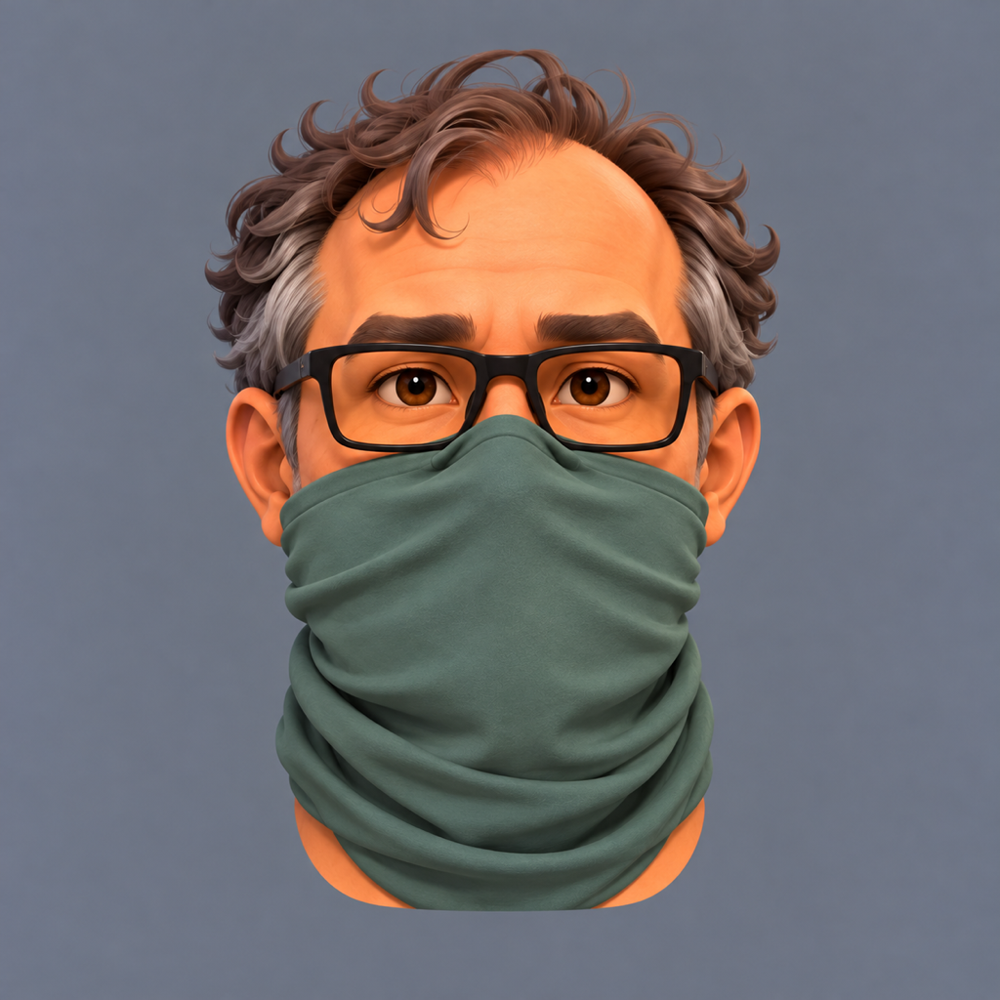
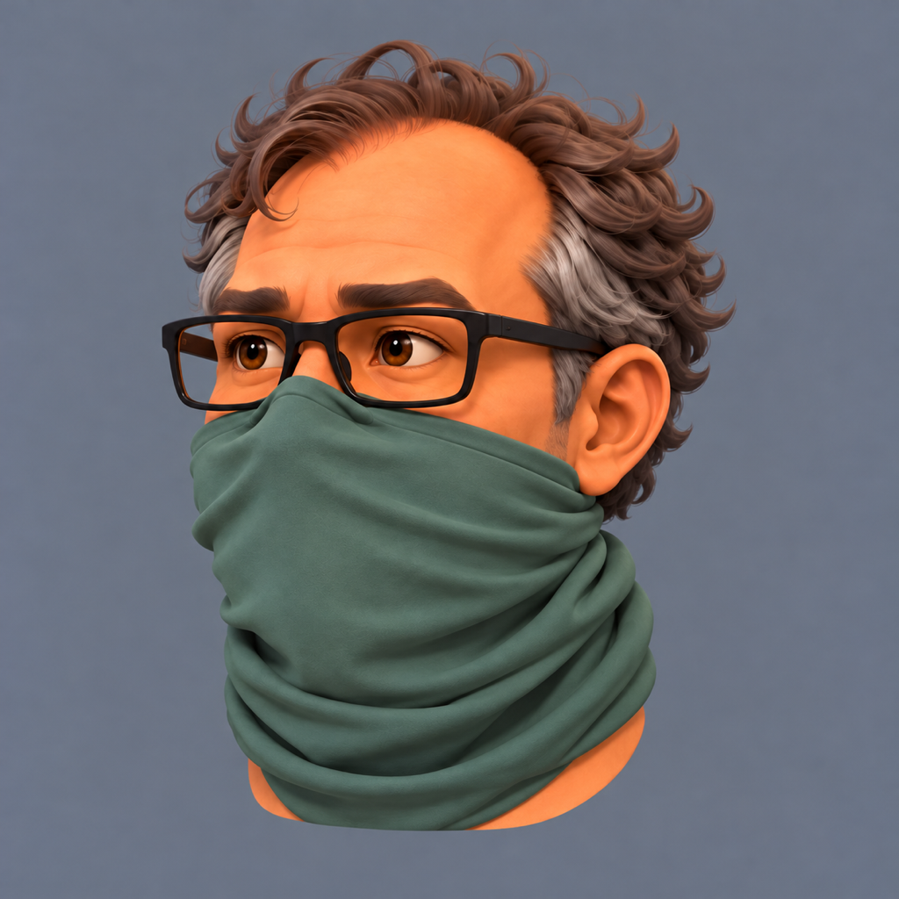
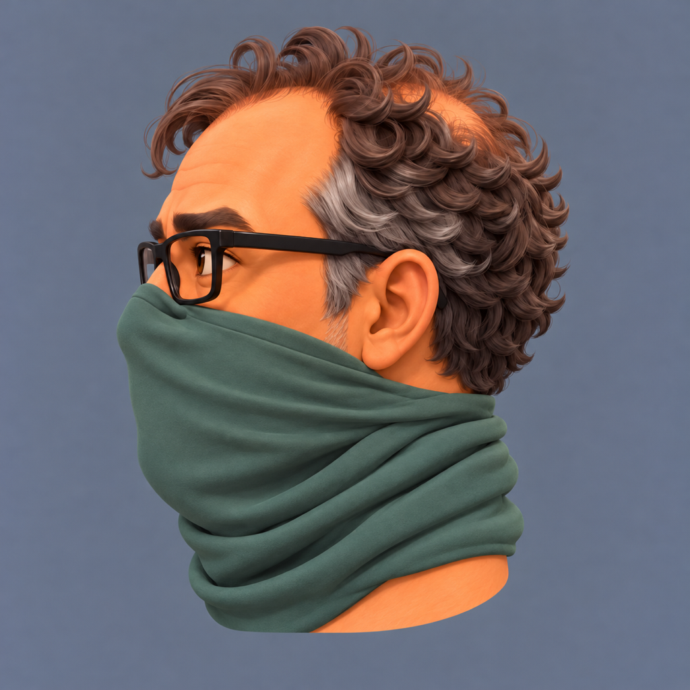
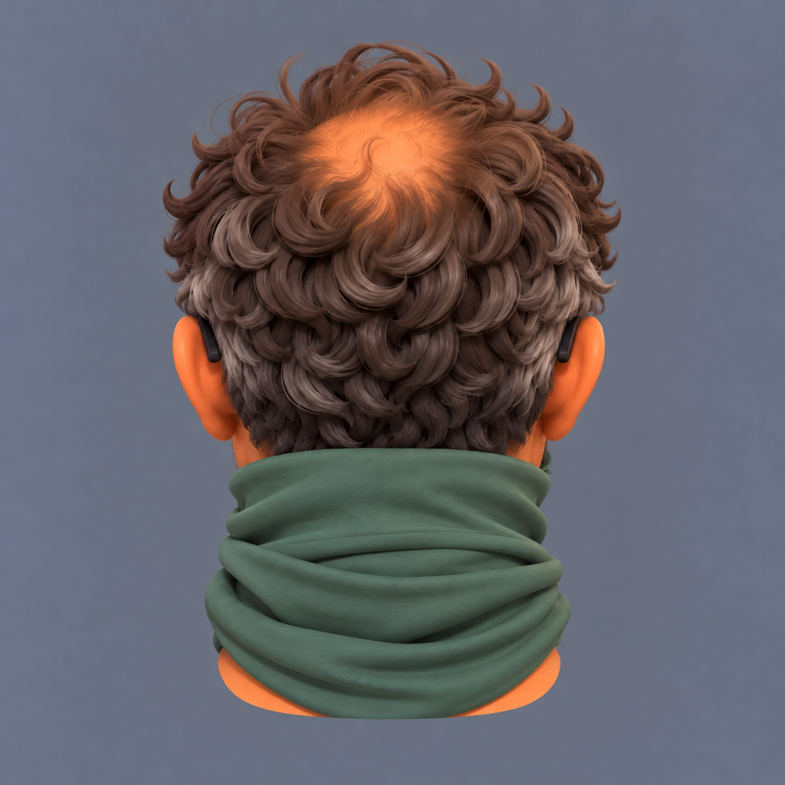

# Request 30: corrected writer and developer Meshy inputs

Six replacement candidates, generated by Astra with the built-in image_gen tool on 2026-10-15,
following [Claude's correction brief](../../briefs/operator-writer-developer-meshy-fixes.md).
These fixes await Bryson's selection. This page combines the fourteen accepted Request 29
views with the six new candidates: **twenty images total, ten per character**.

- Developer: four heads redrawn from his approved sheet, with the protagonist and writer as
  style references. The old developer head images were not inputs.
- Both body profiles: redrawn, a protruding far-arm artifact removed, then aligned with ordinary
  uniform resampling and background padding. No image-tool size correction was used.
- Writer's four head views: kept unchanged after the observable landmark check below.
- Accepted body front/back and packs: unchanged. No source promotion or Meshy run.

[Exact prompts](prompts.json) · [Pixel measurements and transforms](measurements.json) ·
[Hashes and full twenty-view assembly](manifest.json)

## Style comparison

The three front heads at the same image size, shown at 50% without changing their framing.
Astra's visual check: the new developer has smoother face planes, broader cloth folds and
shaped curls, bringing him closer to the accepted cast. Bryson's creative selection remains open.

## Body scale measurements

Zero-based pixel coordinates in the 1024 × 1536 files. Height includes the top and bottom rows.
Hair top and boot-sole bottom measured by row-wise difference from the background; thresholds
25, 35 and 45 were compared on the accepted originals, giving about 2 px boundary uncertainty.
The working measurement uses threshold 35 and at least five foreground pixels per row.

| Character | View | Hair top y | Sole bottom y | Height px | Height delta from front | Baseline delta |
|---|---|---:|---:|---:|---:|---:|
| Writer | front (accepted) | 163 | 1339 | 1177 | +0 | +0 |
| Writer | back (accepted) | 157 | 1331 | 1175 | -2 | -8 |
| Writer | side (new) | 163 | 1339 | 1177 | +0 | +0 |
| Developer | front (accepted) | 167 | 1291 | 1125 | +0 | +0 |
| Developer | back (accepted) | 166 | 1283 | 1118 | -7 | -8 |
| Developer | side (new) | 169 | 1291 | 1123 | -2 | +0 |

The new writer profile matches the front height and baseline. The developer matches the baseline
and is two pixels shorter (0.18%), within the brief's roughly 2% / 25 px tolerance. The previous
profiles were 88 px and 70 px shorter respectively. Alignment preserves the whole rendered image:
no subject extraction, stretching or matte edge. Only the empty outer background margins were
blended into the added background; the foreground was verified outside the blend region.

## Writer head scale check

Coordinates in the unchanged 1024 × 1024 originals. Eye-line centers were read against an
8 px grid (about ±5 px); bandana bottoms were measured by color threshold. The anatomical
skull surface is hidden by opaque hair in every view, so the visible hair crown is reported as
a framing proxy, not as a measured skull. Rear eyes and the rear neck cut are also occluded.

| View | Visible hair top y | Eye line y | Bandana bottom at cut y |
|---|---:|---:|---:|
| front | 40 | 433 | 985 |
| side | 25 | 407 | 961 |
| three-quarter | 33 | 419 | 977 |
| back | 32 | occluded | occluded |

Observable spreads are 15 px for the hair crown, about 26 px for the eye line, and 24 px for the
bandana cut, each within about 3% of the image height (31 px). Keep the accepted writer heads.
This check cannot verify the hidden anatomical skull or rear cut; no values were invented for them.

## Small pack detail for Bryson

Distinct old stickers are not readable on the developer's rig; its worn blank patches do not
clearly establish them. The three accepted pack images stay unchanged, as the brief directs.
Whether to add stickers remains Bryson's decision.

## Writer: complete ten-view set

Front/back, all four heads and all packs below are the accepted Request 29 files. Only the side
body is a new Request 30 candidate.

| Body front | Body back | Body left profile |
|---|---|---|
|  |  |  |

| Head front | Head left three-quarter |
|---|---|
|  |  |

| Head left profile | Head back |
|---|---|
|  |  |

| Pack back | Pack rear three-quarter | Pack left camera-side profile |
|---|---|---|
|  |  |  |

## Developer: complete ten-view set

Front/back and all packs below are the accepted Request 29 files. The side body and four heads
are new Request 30 candidates.

| Body front | Body back | Body left profile |
|---|---|---|
|  |  |  |

| Head front | Head left three-quarter |
|---|---|
|  |  |

| Head left profile | Head back |
|---|---|
|  |  |

| Pack back | Pack rear three-quarter | Pack right camera-side profile |
|---|---|---|
|  |  |  |

## Selection and modeling handoff

After Bryson picks the fixes, copy the twenty views named in the manifest (ten per character)
unchanged into the two source folders. Retire the old 512 px pack crops as the brief directs,
and mark Requests 29 and 30 delivered. The six superseded Request 29 views stay as history;
use this page and the manifest to assemble the current set. No Meshy generation has been run.
