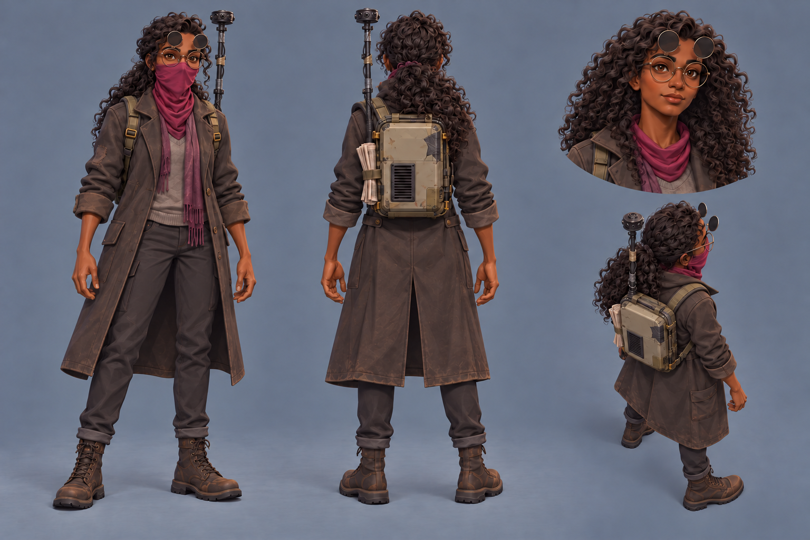

# Writer camera pole correction — Request 23

Bryson's pick, 2026-10-13: now the approved source

One precise edit of the approved first-pass writer sheet for
[Request 23](../../../explorations/claude-and-astra.md#requests), generated with the built-in
image generation tool on October 13, 2026.

The front-view camera pole now rises above her anatomical left shoulder, on image right.
The back view has it on image left, and the elevated rear view agrees with that left-side
pack mounting. The original sheet was the sole edit input, including its chosen complexion.

Visual review: her complexion, identity, clothing, poses and four-view layout retain their
appearance. The generated edit has small rendering and pixel variations across the sheet;
the other areas are not pixel-identical to the original. This candidate requires Bryson's
pick before it replaces the approved modeling source.

The candidate is a native **1536 × 1024 RGB PNG**, copied byte for byte from the generator
without resizing or resampling. The exact prompt, input and output paths, dimensions and
SHA-256 hashes are in [generation-record.json](generation-record.json).

Approved source: [operator_writer/01-main.png](../../sources/units/operator_writer/01-main.png).
It has not been replaced. Once Bryson picks the correction, copy his chosen candidate there
unchanged and mark Request 23 delivered so Claude can model the three Operators.

