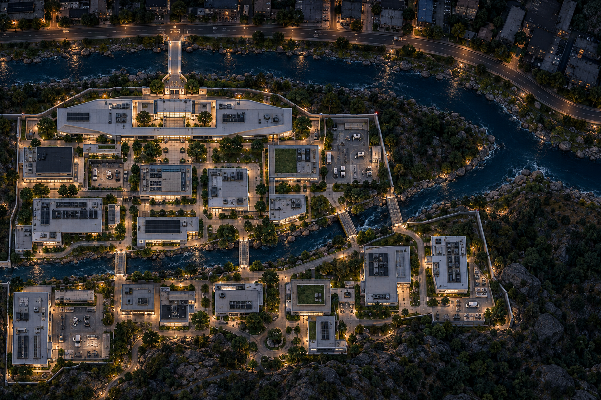

# River campus layout study — 2026-10-10

Exploratory concept based on Bryson’s new site sketch; pending his review. This replaces the earlier ornamental-pool assumption for this study, without adopting a final level layout.

The city and public road run across the top. An entrance bridge crosses the front river to headquarters. The research park extends behind it, with a second river branch passing through the grounds and connecting to the front branch at the right. Robotics and computing facilities replace the earlier greenhouse emphasis.

The image preserves the major relationships but is not a measured architectural plan. Some building elevations remain visible, and the generator rendered four internal crossings rather than the three in the prompt. Exact terrain, dimensions and traversal remain unresolved.

The original sketch, exact prompt and generation record are saved alongside the image. No game code or adopted design documents changed.
