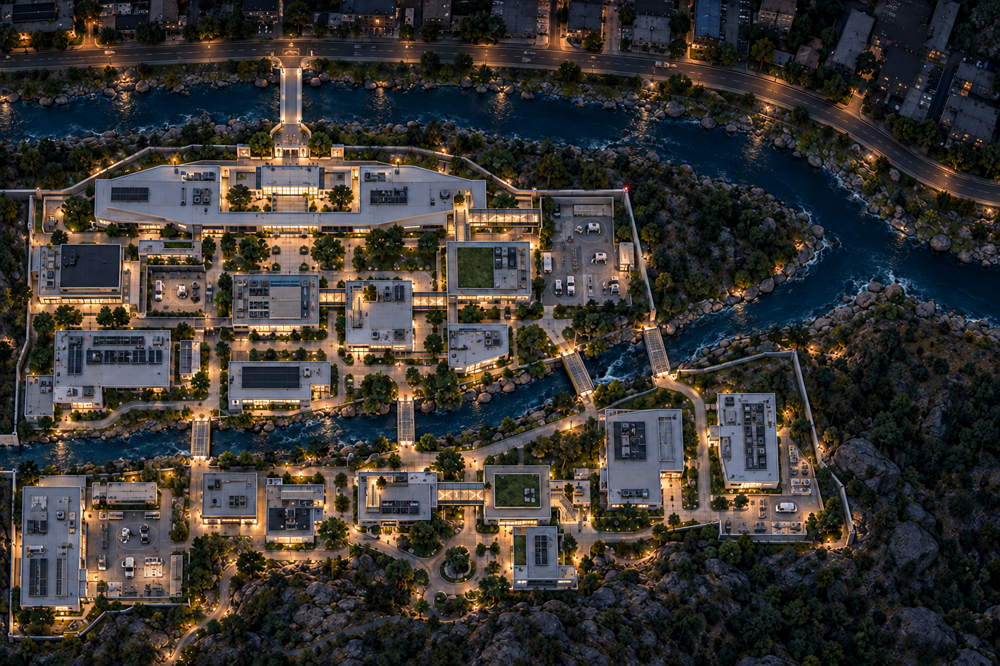
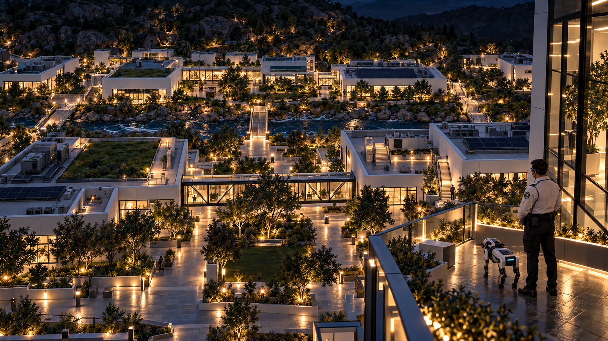
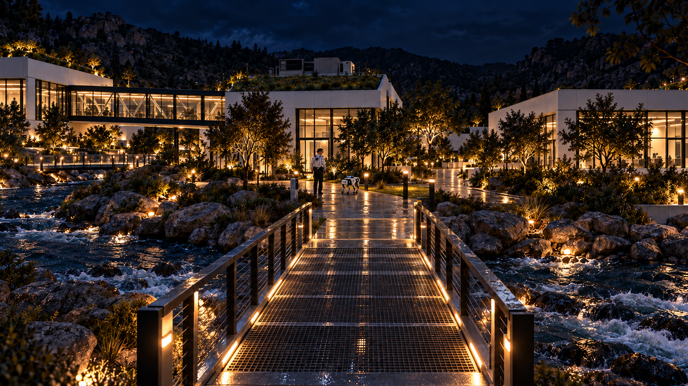
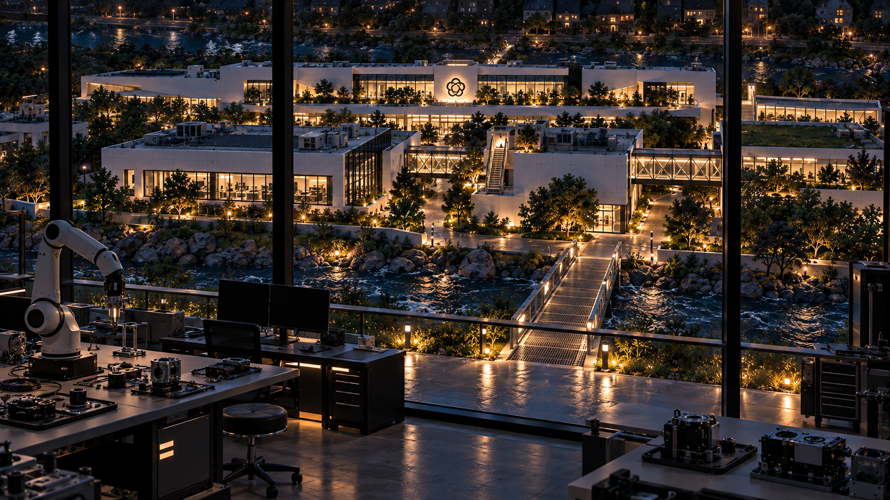

# River campus views — 2026-10-10

Concept study pending Bryson review. Uses the new river-campus overhead for layout and the two supplied front images for architecture. Earlier rear-campus designs were excluded.

## Updated overhead

## Headquarters rear terrace

## Central river crossing, looking south

## Robotics laboratory, looking north

The updated overhead includes enclosed elevated hallways, roof stairs and low grated river crossings. It remains the layout authority. These are generated concept interpretations: building proportions, spacing, elevations and corridor counts vary across views and are not an exact reconstruction. The river-level view received a targeted correction to place the eastern hallway on camera-left.

Generated with built-in image_gen. Exact prompts and reference paths are in prompts-and-references.json; final source paths and correction prompt are in generation-record.json. Architecture reference copies are included. No game code or adopted design documents changed.
