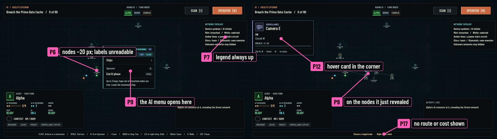
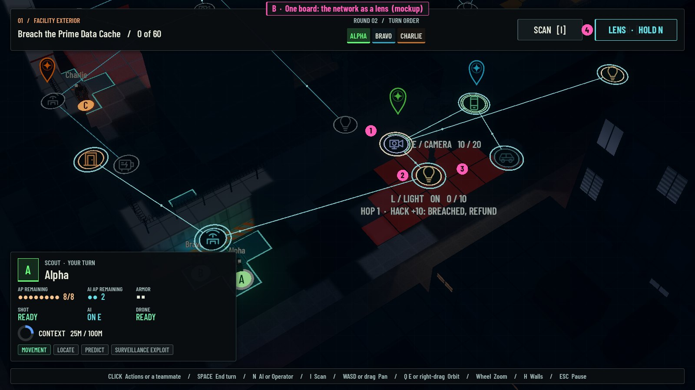
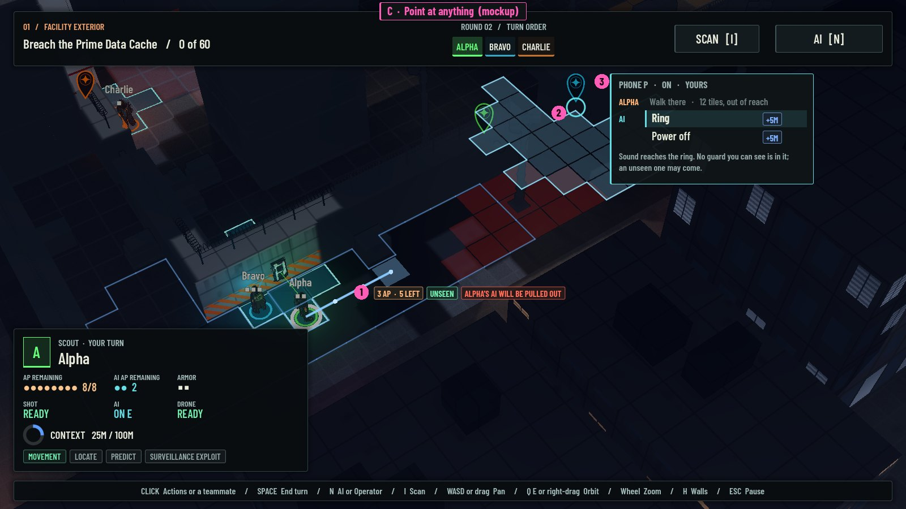
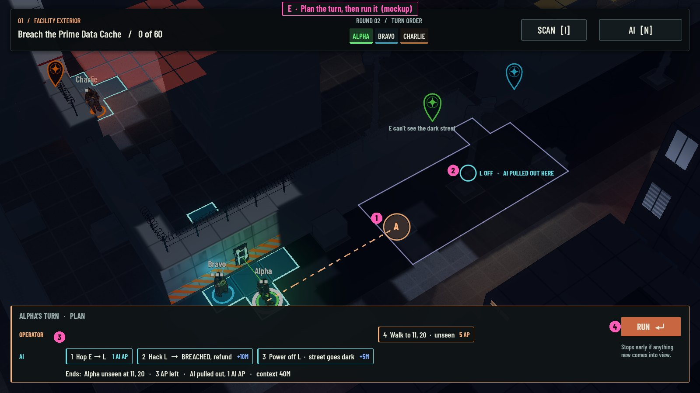

# UI rethink: Claude's proposals

Phase 1 of [the UI rethink](../ui-rethink.md), written alone from [the prompt](../ui-rethink.md#the-prompt)
on 2026-10-29. Images: `art/concepts/ui-rethink-2026-10-29/claude/`. Build: `main` at d0e3de7.

## In short

- **What's wrong (seen and read):** the two halves of a turn are two places. Going to the AI's half
  moves the camera, hides the physical world and locks input for about 1.5 s; coming back costs about
  1.1 s more. Device orders exist only in the network view, but every effect they have is physical.
  The sound preview, the cones and the aim lines are drawn under the network view's backdrop, so a
  verb's main preview is invisible where the verb is chosen. The network view frames the whole map,
  so the working network is tiny, and it spends color on node kinds, so nothing can stand out. That's
  the clutter Bryson describes when little is on screen.
- **What I recommend:** one board. The network becomes a lens over the physical view instead of a
  place to go (direction B), and actions live on the things you point at, for both halves, instead
  of in the unit's menu (direction C). Every action shows its consequence on the board before you
  commit. Two experiments of a day or two each test it: a lens toggle, and a device strip with
  click-to-move.
- **Six directions,** from conservative to radical: A tidy the two views, B network lens, C point at
  anything, D a docked network instrument, E plan the turn then run it, F the AI paints the world.
- **Two bugs found on the way** (P4, P15), independent of any redesign. Ten questions at the end.

## Terms

Game terms (AP, AI AP, context, Breached, hop, tether, cone tiers, aim line, Predict, refund) are as
in RULES.md's glossary. New terms used here:

| Term | Meaning in this report |
|---|---|
| Half | One of an Operator's two halves of a turn: the Operator's (physical) or the AI's (network) |
| View | What the camera shows. Today there are two: the physical view and the network view |
| Switch | Going from one view to the other: N, the AI row, or the Operator row |
| Pick | Today's step after choosing an action that needs a target: tiles or nodes ring and the next click chooses |
| Lens (proposed) | A display mode that redraws the same board, from the same camera, with another layer on top |
| Action strip (proposed) | A small set of actions that opens at the thing you point at, not at the unit |
| Consequence preview | Showing on the board, before you commit, what an action will change: route, AP left, who sees you, what a sound draws |
| Ambient network (proposed) | The few network marks that stay on in the physical view: what the AI can reach, breach progress, AI tokens |
| Schematic | A network diagram laid out for reading, not at the devices' map positions |
| Linked highlight | Pointing at something in one place lights up the same thing in another |
| Commit point | (from genre basics) where an action can't be taken back, because it revealed something or the world responded |
| Salience | How strongly something draws the eye |
| World-space / screen-space | Drawn in the 3D scene, on things / drawn on the flat screen, in panels |
| Diegetic | Shown in the game's world and fiction rather than in screen-corner panels |

How each claim is labelled: **Seen** is in a capture from my run. **Read** is from the code.
**Inferred** is my reading. **Recommended** is a proposal. Bryson's own words are quoted from the
exploration file.

## How I looked at the game

**Run, not played by hand.** The game window wouldn't take background clicks while the desktop was on
a full-screen Space, and taking over the screen wasn't mine to do. So I ran the real battle scene from
a scratch script (kept out of the repo) that drives it the way `tests/test_battle_flow.gd` does:
the battle's own click handler, menu rows and keys, inside a 1600×900 viewport so hover cards could
be triggered without moving the real cursor. I saved about 40 frames: Alpha's and Bravo's first turns
played through their menus (Charlie's staged), two AI deployments, a hack, a breach with refund, the
turn changes and an enemy round. That shows what the screen looks like and what the clicks do; it
doesn't show how it feels to play, which only Bryson can judge.

**Staged states,** marked where used: Charlie placed beside access point B so the facility network
shows; phone P powered so Ring can be previewed; Alpha placed at the gate's mouth in round 2 to draw an
alert.

**What a modest first turn took (Seen).** Walk to the access point, send the AI in, hop to a camera,
hack it, come back: 9 to 11 clicks depending on shortcuts, two switches (about 2.6 s with input
locked), and the AI's menu opened on top of the nodes it had just revealed.

## Diagnosis

Images with the problem numbers marked:
[network on turn one](../../art/concepts/ui-rethink-2026-10-29/claude/diag-1-network-turn-one.jpg),
[the facility network](../../art/concepts/ui-rethink-2026-10-29/claude/diag-2-facility-network.jpg),
[the hidden Ring preview](../../art/concepts/ui-rethink-2026-10-29/claude/diag-3-ring-preview-hidden.jpg),
[a move's hover](../../art/concepts/ui-rethink-2026-10-29/claude/diag-4-move-hover.jpg),
[a turn change](../../art/concepts/ui-rethink-2026-10-29/claude/diag-5-turn-change.jpg),
[after an enemy round](../../art/concepts/ui-rethink-2026-10-29/claude/diag-6-enemy-round.jpg).

### The switch between halves

| # | Moment | Problem | Evidence |
|---|---|---|---|
| P1 | Pressing N or the AI row | Switching is a scene change, not a glance. The camera glides overhead (0.5 s), the network fades in, holds and the map blurs away (1.05 s); input is locked throughout. Back is about 1.1 s. The camera reframes to the whole map, so where you were looking is gone. Rule 3 says the halves interleave freely; the view makes interleaving the expensive path | Seen: 04 to 06. Read: `battle.gd` `_set_network`, `network_view.gd` `fade_in`, `camera_rig.gd` `overhead` |
| P2 | Any moment | Each view hides the other layer. The network view drops walls, cones, aim lines and fog; team and seen enemies become discs and diamonds. The physical view shows the network only as access-point signs, AI pins and, with I, badges on Breached devices. What connects the two (this camera covers that street; this light is on hub W's circuit) has to be held in memory | Seen: diag-1, diag-2 vs diag-5 |
| P3 | Wanting to ring the phone | Device orders exist only in the network view, but their effects are all physical: a lure, a dark street, a car rolling | Read: `battle.gd` `_click` reads nodes only while the network is shown |
| P4 | Hovering Ring on a powered phone | The hint says "Sound reaches the blue area", but no area is drawn. Floor overlays sit under the network backdrop, so the sound ring, the guards it draws, cones and aim lines are invisible in the only view where verbs are chosen. **A bug**, fixable on its own | Seen (staged): diag-3. Read: backdrop `render_priority` 1 above the overlays |
| P5 | Ending a turn | Two end rows: "End Operator phase" hands over to the AI and "End AI phase" hands back; "End turn" appears only once the other half has nothing to spend. Space does whatever the row says, so its meaning changes with the view | Seen: 02, 06. Read: `battle_menus.gd` `_end_half`, `battle.gd` `_hands_over` |

### The network view

| # | Moment | Problem | Evidence |
|---|---|---|---|
| P6 | Turn one, AI deployed | The overhead camera fits every shown node, and all four access points always show, so the working network sits in a fifth of the screen: node discs about 20 px, labels about 6 px tall. With the facility revealed, about 25 nodes share 520×370 px | Seen: diag-1, diag-2. Read: `framing_bounds` |
| P7 | Any network screen | Color is spent on categories: 14 node kinds share a dozen hues, three of them near-identical cyans, then mint means Breached, white selected, amber circuit, darker unpowered, red alerted. With everything colored, nothing stands out, and a legend panel must stay up to decode it. This is the clutter "even when very little is on screen" | Seen: diag-2. Read: `NetworkView.COLORS` |
| P8 | Facility revealed | Every node carries the same two-line label at the same weight ("W / POWER HUB", "ON 0 / 30"), near or far, in reach or not. Hub W's circuit lines cross the whole diagram | Seen: diag-2 |
| P9 | Deploying, or opening a device | Menus land on what you're deciding about. The AI's menu opens beside its pin, which is where the newly revealed street nodes appear; the device menu covers the phone it controls | Seen: diag-1, diag-3. Read: `_open_menu` anchors at the AI's pin |
| P10 | AI still in the backpack | Two prompts for one action: a banner says "Click a ringed access point" while the open menu offers "Deploy at A" | Seen: 06, 07 |

### The physical view

| # | Moment | Problem | Evidence |
|---|---|---|---|
| P11 | Moving | Three clicks (Operator, Move, tile). The reach floods the floor blue; no route is drawn; the destination's cost, exposure and its biggest consequence ("Alpha's AI will be pulled out") appear only in the hover card | Seen: diag-4. Read: `_pick_move` |
| P12 | Any hover | The hover card is pinned to the top-left corner, up to about 900 px from what it describes | Seen: diag-1, diag-4 |
| P13 | Any moment | Panels cover the board and the team: about 30% of the screen in the physical view, 33% in the network view, before any menu or card. The unit panel hid Charlie and half of Bravo at the start; the log stays up across turns once anything is logged; move tiles run under the panel | Seen: 04, diag-4, diag-5 (measured on captures, approximate) |
| P14 | Back from a hack | The physical view doesn't show what changed. The camera stays on the Operator; Alpha's AI pin was cut off behind the header; camera E's 10 / 20 appears nowhere in the world. Scan (I) lists only Breached devices, so it showed nothing, and after Bravo's breach the phone was off screen | Seen: diag-5, 14, 15, 27 |
| P15 | Bravo's turn starts | The unit panel still shows Alpha, "WAITING", and at Charlie's turn it showed Bravo. Clicking the active Operator to open her menu pins the panel to her. **A bug**, fixable on its own | Seen: diag-5. Read: `hud.gd` `show_turn` keeps `_viewed` |

### Seeing effects before and after

| # | Moment | Problem | Evidence |
|---|---|---|---|
| P16 | Choosing Hack E | The row reads "+10 · +15M · 1 AI AP". It doesn't say the camera will stand at 10 / 20, not breached, no refund, with no AI AP left. Afterwards the result shows only in the 6 px node label and the log. Genre basics item 36 asked for this | Seen: 10, 11 |
| P17 | Choosing where the AI hops | While picking, the menu is closed, so its cost tags are gone; no hop route is drawn; the hint reads "Choose a ringed node" | Seen: diag-1 |
| P18 | After the enemy round | Threats arrive as text. The log says "Someone sees Alpha! Full alert" and "Someone aims at Alpha"; the aim line is thin; who saw her isn't marked; caution is one word under the objective; a G1 chip joins the turn order | Seen (staged): diag-6 |
| P19 | After a hack that doesn't breach | The AI's menu reopens by itself, the one action that still does since the menu change of 2026-10-28 | Seen: 11. Read: `_open_breached` |
| P20 | Calm or crisis | Salience is flat: the same panels at the same weight whatever the board is doing. In diag-6 the most urgent fact on the board, that Alpha is shot next turn if she stays, is among the smallest things on screen | Inferred from the captures |

### What already works, and should survive any redesign

- Rules-backed previews on a cloned state (`verb_preview`, Predict): the engine for every
  consequence preview below already exists, and it can't promise what play won't do. **Read.**
- Network nodes sit at their devices' map positions, so a lens over the physical view is mostly a
  camera and drawing change. **Read.**
- Blockers that say why ("Needs power first."), exposure-colored move tiles, the tether warning,
  AI pins over devices in the physical view, the menu staying shut after actions. **Seen.**

### Rules that make the UI's job harder (notes, not proposals)

- Three budgets per turn: Operator AP, AI AP and battle-long context (rules 4, 5, 8). Every preview
  has to speak all three.
- Non-local consequences: the tether pulls the AI out when its Operator walks off (C's mockup shows
  it), relays, free hops out of Breached nodes.
- Verbs gated by power and one order per device per turn, which makes greyed rows that need reasons.
- Hidden guards act out of sight and previews mustn't reveal them ("unseen ones may come"), which caps
  how much any preview can show.

## Research

Earlier research in [genre basics](../genre-basics.md) and
[its report](../../reports/Stealth%20tactics%20basics%20gap%20analysis.md) already took the sound-ring,
telegraph, danger-zone and separate-Matrix lessons; I don't repeat them. Most game sources below are
reviews, guides and wikis; developer statements are marked as such.

| Example | What it does | What it teaches here | What doesn't transfer |
|---|---|---|---|
| Invisible Inc. | Space overlays the same room map with Incognita's view: connections, firewalls, daemons ([everyeye](https://www.everyeye.it/articoli/recensione-invisible-inc-25849.html)). Observe tells you if a guard patrols or stands; red tiles warn of danger outside your vision ([Destructoid](https://www.destructoid.com/to-dye-for-invisible-inc-is-my-kind-of-strategy-stealth-game/)). One alarm dial, 0 to 6 ([Lantz, Game Developer](https://gamedeveloper.com/design/game-design-deep-dive-alarm-systems-in-klei-s-i-invisible-inc-i-)) | The nearest precedent for our two halves keeps one map and one camera; the network is a mode of the board | One shared AI; ours are per Operator, tethered, moving through a graph |
| Watch Dogs 2 | NetHack view tints the world and highlights hackables blue and enemies red, through walls ([wiki](https://watchdogs.fandom.com/wiki/NetHack_View), [Tom's Hardware](https://forums.tomshardware.com/faq/watch-dogs-2-nethack-guide.2886127)). In Watch Dogs 1 you hack a camera to survey an area, and reach a terminal through the camera network when line of sight allows ([Game Informer](https://gameinformer.com/games/watch_dogs/b/pc/archive/2013/07/19/hacking-open-the-world-in-watch-dogs)) | A lens that keeps the world and splits salience between what you can use and what can hurt you; reaching through devices reads best in the world itself | Real-time, third-person; our lens also has to keep cones and tiles readable |
| Deus Ex GO | Hacking reshapes the same board, its tiles, power and platforms, sometimes remotely ([Engadget](https://www.engadget.com/2016-06-08-deus-ex-go-puzzle-level-editor.html), [Destructoid](https://www.destructoid.com/review-deus-ex-go/)) | A turn-based stealth puzzle with no second view, because the hack's effect is the board | Tiny boards, one character |
| Into the Breach | Every enemy attack is telegraphed on the board; one button shows attack order; Ctrl-hover gives detail ([Game Informer](https://gameinformer.com/b/features/archive/2018/02/27/23-tips-to-help-you-dominate-into-the-breach), [Good Games](https://goodgames.substack.com/p/into-the-breach-is-a-good-game-everyone)). Justin Ma: they'd "sacrifice cool ideas for the sake of clarity" ([Game Developer](https://gamedeveloper.com/design/-i-into-the-breach-i-dev-on-ui-design-sacrifice-cool-ideas-for-the-sake-of-clarity-every-time-)) | Threats as board state, with order; P18 is the opposite | Perfect information; our fog limits what can be telegraphed |
| Tactical Breach Wizards | Tom Francis kept Into the Breach-style previews because players don't enjoy testing 25 tiles to find the one that works ([Game Developer](https://gamedeveloper.com/design/tactical-breach-wizards-shows-how-strategy-games-can-tickle-the-funny-bone)). Undo until you end the turn, and a warning before ending by accident ([Shacknews](https://www.shacknews.com/article/141015/tactical-breach-wizards-review-score)). He started from frustration with XCOM 2's clarity ([PCGamesN](https://www.pcgamesn.com/tactical-breach-wizards/xcom)) | Previews are the price of deep combinations; an end-turn guard instead of two end rows | Undo; rule 4 says none in V1 |
| XCOM 2 | Concealment shows red detection tiles ([UFOpaedia](https://ufopaedia.org/Concealment_(XCOM2))). Hacking opens a separate screen with odds and a reward choice ([UFOpaedia](https://ufopaedia.org/Specialist_(XCOM2)), [PC Gamer](https://pcgamer.com/going-deeper-into-xcom-2-resistance-isnt-futile/2)) | Exposure tiles work (we have them). The hack screen is the counterexample: a second place for the second layer | Dice and odds |
| Cyber Knights: Flashpoint | Hacking is a separate node minigame that "could almost be its own game" ([RPGFan](https://www.rpgfan.com/review/cyber-knights-flashpoint/)); the later Wireghost class reaches the Matrix through devices directly ([Turn Based Lovers](https://turnbasedlovers.com/news/from-stealth-to-skipjack-new-wireghost-class-arrives-in-tactical-strategy-rpg-cyber-knights/)) | Inferred: after shipping the separate-layer way in, the developers added a device-first way | The minigame itself |
| Desperados III / Shadow Tactics | A blue noise radius before acting, with ear icons at the screen edge for listeners off screen ([Player2](https://www.player2.net.au/2020/06/14-darn-tootin-tips-for-desperados-iii/)). Right-click a spot to see who watches it: an eye and dashed lines to each watcher ([SuperCheats](https://www.supercheats.com/desperados-3-walkthrough-guide/enemy-field-of-view)). Showdown pauses to queue orders, then runs them together ([Gamepressure](https://www.gamepressure.com/desperados-iii/showdown-mode/zfe2ec)). Shadow Tactics players asked for the cursor to color by cone tier ([Steam](https://steamcommunity.com/app/418240/discussions/0/1290691937705159737)) | "Who watches this tile?" is the query our move preview lacks (P11). Off-screen listeners shown at the edge. Queue then execute | Real-time with pause; our turns already pause |
| Mark of the Ninja | Rings show how far a noise carries, and you know how loud before you act ([GamesBeat](https://gamesbeat.com/mark-of-the-ninja-preview/)) | Our ring is right in principle and invisible in practice (P4) | 2D side view |
| Frozen Synapse | Plan, give hypothetical orders to enemy "ghosts", simulate, then Prime ([Giant Bomb](https://giantbomb.com/wiki/Games/Frozen_Synapse), [PC Gamer](https://www.pcgamer.com/frozen-synapse-review)) | Simulation as the preview; ghosts for what you can't see | Simultaneous turns |
| Hacknet | One screen: terminal, display, network map and a RAM bar that programs visibly fill ([Scientific Gamer](https://scientificgamer.com/thoughts-hacknet/), [Player2](https://www.player2.net.au/2015/08/hacknet/)) | Context could read as a bar of blocks, one per loaded chip. A network map can stay small when detail lives elsewhere | No physical world; typed commands |
| Phantom Doctrine | Infiltration mode with a mode readout; spotting only matters in restricted zones ([Gamepressure](https://www.gamepressure.com/phantom-doctrine/interface/z0b329), [Wikipedia](https://en.wikipedia.org/wiki/Phantom_Doctrine)) | Rule-changing areas belong on the map as areas: caution as a painted zone, not a word (P18) | Disguises |
| Mario + Rabbids | Dash hits an enemy while moving; Team Jump launches off an ally, inside the move ([Pixel Twelve](https://pixeltwelve.com/guides/mario-rabbids-kingdom-battle-beginner-guide-first-battles-cover-dash-team-jump), [Super Mario Wiki](https://www.mariowiki.com/Team_Jump_(Mario_%2B_Rabbids_series))) | Secondary actions folded into the move gesture rather than separate menu steps | No stealth |
| Gears Tactics | Overwatch is a cone you drag out; you see the enemy's cones too ([PC Gamer](https://www.pcgamer.com/gears-tactics-is-a-shockingly-good-strategy-game)). "Tactical clarity" is a pillar of the enemy AI ([Game Developer](https://gamedeveloper.com/design/how-ai-helps-achieve-tactical-clarity-in-gears-tactics)) | Shape as input; enemy zones always readable | No grid |
| Hitman GO | Every enemy piece has a pointer for its sight or next move; enemy types have their own colors ([Wikipedia](https://en.wikipedia.org/wiki/Hitman_Go)) | Intent marks belong on the piece | Fixed tiny boards |
| Oxygen Not Included | Overlays show power and automation on the same map, the power grid colored by state: healthy, near its limit, overloaded, idle ([wiki](https://oxygennotincluded.wiki.gg/wiki/Guide/Power_Circuits)) | Circuits in place, on demand, colored by state, not kind | Not turn-based |
| ISA-101 control-room screens | Grey for normal; saturated color only for abnormal states, so alarms stand out ([ISA](https://blog.isa.org/the-high-performance-hmi), [study guide](https://open-exam-prep.com/study-guides/isa-cap/system-design-hmi-alarms-enterprise/hmi-design-isa101)) | The cure for P7: kind by icon, color for state and danger | Industrial plant, not a game |
| Air-traffic labels | Each radar target has a short label and an extended one on demand, joined by a leader line; automatic de-cluttering can't solve every overlap ([EUROCONTROL](https://www.eurocontrol.int/publication/requirements-implementation-automatic-and-manual-label-anti-overlap-functions), [SkyRadar](https://www.skyradar.com/blog/understanding-plots-tracks-and-labels-in-the-plan-position-indicator)) | Two label levels; tags tied to their thing | Moving targets, trained operators |
| Excel's Trace Dependents | Arrows on demand from a cell to everything that depends on it ([Microsoft](https://support.microsoft.com/en-us/excel/display-the-relationships-between-formulas-and-cells)) | Relationships on demand: what this hub powers, who hears this ring | Spreadsheet |

**Where it converges (Inferred):**

1. One board, redrawn, beats a second place. The examples that do two layers well keep the camera and
   recolor (Invisible Inc., NetHack, Oxygen Not Included, Deus Ex GO). Separate screens (XCOM 2's
   hack, Cyber Knights' minigame, Shadowrun Returns' Matrix in the earlier research) are the ones
   reviewers call separate.
2. Consequences are drawn where the choice is made, before commit.
3. Enemy intent lives on the enemy, with its order.
4. Color is for state and danger; shape and icon carry kind.
5. Labels come in two levels and stay tied to their thing.
6. Relationships are shown on demand: who watches this tile, what this hub powers, who hears this.

## Six directions

Each mockup is a sketch drawn over a real frame of the round-2 state. Where a mockup shows numbers
(AP, context, a route, a sound's reach, the tether warning), they come from the rules run on that
state or a clone of it, not from my guesses. Pink numbers in each image match the list under it.

### A. Two views, done right (conservative)

**Core idea.** Keep the physical view, the network view and the switch; fix what makes each clumsy.

- **Turn.** As today: click the Operator, act from the menu, N to switch. The switch becomes a quick
  cross-fade that keeps the camera's center; the network view frames the active AI's network, not the
  whole map.
- **Before.** The hover card sits beside the cursor. Hack rows state the outcome: "10 / 20, still
  short, no refund". Previews (sound, responders, cones) draw above the network backdrop. A move
  draws its route and the AP left.
- **After.** A short result tag at the node ("+10 · 10 / 20"). Coming back from the network, the
  camera shows the device that changed for a beat.
- **Reacts to the board.** Nodes in reach are bright and labeled; the rest grey and unlabeled.
  Circuits show only when a hub or member is hovered. Color is kept for state and danger.
- **Removes.** The legend; labels on far nodes; per-kind colors; the deploy banner; the log shrinks to
  one line that expands on hover.
- **Mockup.** [mock-a-two-views.jpg](../../art/concepts/ui-rethink-2026-10-29/claude/mock-a-two-views.jpg):
  1 framed to the street network, labels readable; 2 nodes in reach labeled, the facility grey;
  3 the Ring preview and camera E's cone drawn above the backdrop; 4 the menu clear of the nodes;
  5 the log as one line.
- **Look and camera.** Physical view unchanged. The network view's colors and framing change.
- **Risks and costs.** Cheap, but it keeps two places and the switch. It answers clutter, not
  seamlessness, and isn't the rethink Bryson asked for. Mostly view code in `network_view.gd`,
  `hud.gd` and `battle.gd`.
- **Smallest experiment (A-1, a day).** "Quiet network": framing to the active AI's reach, grey out of
  reach, labels on hover and reach, previews above the backdrop, menu placed away from nodes.

### B. One board: the network as a lens (recommended)

**Core idea.** There's no network view to go to. The network is a lens over the same board and
camera: hold N and the world dims while devices light up in place with their links; let go and it
fades. The AI acts on devices in the world.

- **Turn.** The turn starts on the Operator. A few network marks stay on all the time: the AI's token
  on its device (today's pin), and a faint mark on each device its AI can reach. Holding N shows the
  whole network in place: links, breach progress, circuits on hover. You act on devices from either
  state (with C's strips, or today's device menu opening where you click), so the lens is for
  reading, not a place you must be in to act. There's nothing to switch back from.
- **Before.** The AI's actions preview their physical effects in place, because the world is right
  there: Power off L shows the pool of light that goes dark; Ring P shows the sound ring and any
  guard it draws; a hop shows its route along the links with its hop count.
- **After.** The device itself changes (light out, cone gone, door unlocked) with a short tag at the
  device, and the ambient marks update.
- **Reacts to the board.** Brightness follows relevance: in reach bright, out of reach dim; a device
  whose cone touches a teammate's path is marked; threats keep full strength while scenery dims.
  Labels show only for the hovered node and the AI's own, as short tags, with detail on hover.
- **Removes.** The overhead camera move, the blur, the legend, the network framing, the AI menu as a
  place, and the separate end row for the AI's half.
- **Mockup.** [mock-b-network-lens.jpg](../../art/concepts/ui-rethink-2026-10-29/claude/mock-b-network-lens.jpg),
  made by drawing today's real network nodes from the physical camera with the backdrop at about 60%:
  1 camera E with Alpha's AI and its tag; 2 hovering light L, whose tag says what a hop and a hack
  would do; 3 camera E's cone kept at full strength over the dimmed world; 4 "Lens · hold N" in place
  of the switch.

  
- **Look and camera.** This direction changes the network's look plainly: no overhead diagram;
  nodes and links are drawn in perspective on the board. The physical view and its camera stay.
- **Risks and costs.** Nodes on walls and poles sit at different heights in perspective and can hide
  behind walls; links crossing a 3D scene can tangle; a dense room may clutter at a low camera angle;
  orbiting moves labels. Mitigations: only the active AI's network at full strength, circuits on
  demand, the existing wall ghosting (H), screen-space label placement. Medium cost: the network
  pieces exist; the work is camera handling, draw order and label layout.
- **Smallest experiment (B-1, a day).** A toggle that shows the existing network view in place over
  the physical camera, with no camera move: backdrop at about 60%, cones and previews above it,
  circuits on hover, labels for reach and hover only. Bryson plays a turn with it held and judges
  whether he can read both layers at once.

### C. Point at anything: actions live on targets (recommended)

**Core idea.** The unit's menu stops being the way in. Point at a tile, a door, a device or a guard,
and what both the Operator and her AI can do there appears at that thing, each action with its
consequence preview. Hovering previews; clicking commits.

- **Turn.** The active Operator is implicitly selected. Hover a tile: the route, AP left, exposure and
  tether consequence draw on the board; click to move (two steps instead of three, no menu). Click a
  device: a strip opens at it with two lanes, the Operator's (open, peek, lock, or "walk there") and
  the AI's (hop here, hack with its outcome, its verbs with their effects). Click a guard: shoot,
  Predict, Locate. Clicking the Operator keeps only self actions: overwatch, gear, robot, chips,
  compaction, end turn. The halves are lanes in a strip, so there's no switch.
- **Before.** Hovering a strip row draws its effect on the board: sound ring, responders, the route a
  drawn guard would take, cones that would change, AP, AI AP and context after.
- **After.** A tag at the target; the strip closes; lasting marks stay (a drawn guard's
  "investigating" line).
- **Reacts to the board.** Each strip holds only what applies to that target now, greyed rows keep
  their reasons, and a target that's part of a threat (the camera watching your route) says so.
- **Removes.** The Operator menu as gateway (Move, AI, the end rows), the AI menu, and the pick step for
  the common actions. Move tiles become an outline; only warning tiles are filled.
- **Mockup.** [mock-c-point-at-anything.jpg](../../art/concepts/ui-rethink-2026-10-29/claude/mock-c-point-at-anything.jpg):
  1 hovering a tile: route, "3 AP · 5 left · unseen", and in red "Alpha's AI will be pulled out", all
  from the rules; 2 the Ring preview drawn around phone P on the board; 3 the strip at the phone, with
  Alpha's lane and her AI's lane.

  
- **Look and camera.** No change to the 3D look or camera; new strip UI; the move overlay becomes an
  outline.
- **Risks and costs.** Self actions are less discoverable; targets overlap (a guard on a door's tile, a
  body on a dumpster); strips must be placed off the area they preview (P9 again); targets that aren't
  things (flashbang area, robot placement) still need a pick; controller play needs a cursor or
  cycling. Medium cost: `BattleMenus` already builds per-object actions with blockers
  (`door_actions`, `device_actions`).
- **Smallest experiment (C-1 and C-2, one or two days).** C-1: in the physical view, clicking a device
  in the active AI's reach opens a two-lane strip built from today's menu functions, with the verb
  preview drawn on the board. C-2: hovering a tile shows the route and a cost chip; a click moves, no
  menu.

### D. The network as an instrument: a docked schematic

**Core idea.** The 3D world stays full time, and a docked panel shows the known networks as a clean
schematic, like a transit map, at readable size. It's linked to the world: hover a node in the panel
and its device lights up in the world, and the other way round. The AI acts from the panel or the
world.

- **Turn.** The panel shows the active AI's network expanded and other networks as one-line chips.
  Click a node in the panel or its device in the world to act; the world shows the consequence. No
  switch.
- **Before.** Hovering an AI action highlights its route in the schematic and its effect in the world.
  **After.** The node's state changes in the panel, and the device in the world.
- **Reacts to the board.** In reach large, out of reach small; a node whose device watches a teammate
  is flagged; networks you haven't reached stay collapsed.
- **Removes.** The network view, network labels in the world, the legend.
- **Mockup.** [mock-d-docked-network.jpg](../../art/concepts/ui-rethink-2026-10-29/claude/mock-d-docked-network.jpg):
  1 the street network as a schematic, with AI tokens; 2 hovering L in the panel; 3 the same light
  ringed in the world, joined by a leader; 4 the hovered node's detail. The facility is a collapsed
  chip below.
- **Look and camera.** Adds a panel on the right; the network view goes; no camera change.
- **Risks and costs.** The eye has to travel between panel and world; a schematic loses the physical
  meaning (which room, how far) that makes hacking spatial; it adds a second picture to keep in sync.
  Layout per map needs authoring or a grid-snap pass. Medium cost.
- **Smallest experiment (D-1, one or two days).** A 2D panel that draws the active network from
  snapped map positions, linked highlight both ways; actions still through today's menus.

### E. Plan the turn, then run it (radical)

**Core idea.** An Operator's turn is composed, not executed step by step. You lay down Operator and AI
steps; the board shows the predicted end state as ghosts with every consequence; then Run plays it,
stopping early if anything new comes into view.

- **Turn.** Click tiles and things to add steps; they appear on a timeline in two lanes, Operator
  and AI, in order. Drag to reorder, right-click to drop. Ghosts show where the Operator and the AI
  end up, with AP, AI AP and context totals. Run plays the steps with the usual animation. A step that
  would reveal something (fog, a new network, a guard) is a commit point: the run stops there and the
  rest of the plan waits for a nod.
- **Before.** The strongest of the six: the whole turn's predicted result at once, from the rules on a
  clone. **After.** Where reality left the plan, it's marked ("stopped: Guard 3 spotted").
- **Reacts to the board.** The plan revalidates as you edit; steps that became illegal turn red, with
  the reason.
- **Removes.** Per-action menus and picks; turns become one gesture.
- **Mockup.** [mock-e-plan-and-run.jpg](../../art/concepts/ui-rethink-2026-10-29/claude/mock-e-plan-and-run.jpg):
  1 the ghost of where Alpha ends; 2 light L off and the AI pulled out there; 3 the plan in two
  lanes; 4 Run. The numbers are the rules' on a clone: the hack breaches L with a refund, the street
  goes dark, camera E can't see it, and the walk ends unseen with 3 AP left and context at 40M.
  The plan also exposes a real interplay: walking away pulls the AI out.

  
- **Look and camera.** Adds ghosts and a timeline; no camera change.
- **Risks and costs.** It sits close to undo (rule 4: none in V1), though nothing happens until Run.
  Hidden information caps the preview at each commit point. It changes the rhythm from act-and-react to
  plan-and-watch, which may drain tension. High cost: multi-step previews, stop-on-reveal, a timeline
  UI.
- **Smallest experiment (E-1, two days).** Shift-click adds moves, hops and hacks for one Operator to a
  plan run on `BattleState.clone()`; ghosts and a totals chip; Enter runs it for real and stops at the
  first reveal.

### F. The AI paints the world (radical in presentation)

**Core idea.** The screen corners go quiet. What panels show today moves into the world as the AI
partner's annotations: AP around the Operator's ring, the AI's AP and context on its pin, turn order as
numbers on the team, threats as marks on guards and zones, events as callouts where they happen. In the
fiction, the AI sees through the network and paints what it knows.

- **Turn.** The interaction is today's, or C's; what changes is where information lives. One slim line
  stays at the top: round and objective.
- **Before.** Hovering a move dims the AP pips it would spend on the ring. **After.** Callouts at the
  place ("+10 · 10 / 20" at camera E). The log moves to a key.
- **Reacts to the board.** Annotations scale with danger: urgent ones grow and stay; calm ones fade.
  The AI speaks one short line only when something is worth saying.
- **Removes.** The unit panel, the log panel, the key bar (to pause or help), the legend; the header
  shrinks.
- **Mockup.** [mock-f-ai-paints-the-world.jpg](../../art/concepts/ui-rethink-2026-10-29/claude/mock-f-ai-paints-the-world.jpg):
  1 AP pips around Alpha's ring; 2 her AI's gauge on its pin, AI AP and a context ring; 3 a callout at
  camera E; 4 the AI's one line. Teammates carry turn-order numbers; Charlie, off screen, gets an edge
  marker.
- **Look and camera.** Removes the corner panels; adds world-space marks; no camera change.
- **Risks and costs.** World text competes with the art and is hard to read at some zooms and angles;
  a teammate off screen needs edge markers; context is a battle-long budget that may still deserve a
  fixed place; new players look for numbers in corners. Medium cost.
- **Smallest experiment (F-1, a day).** Hide the unit panel, log and key bar; draw AP pips around the
  active ring and an AI gauge on the pin; numbers on teammates; event callouts at their place (the
  floating text that exists today).

### Side by side

| | A | B | C | D | E | F |
|---|---|---|---|---|---|---|
| Removes the switch | no | yes | yes | yes | yes | no |
| Effects shown before | some | strong | strong | some | strongest | some |
| Effects shown after | some | strong | some | some | strong | strong |
| Cuts clutter | yes | yes | some | yes | some | yes |
| Problems answered | P4, P6–P10, P12, P16–P17 | P1–P4, P6–P10, P14, P17 | P3, P5, P9, P11–P12, P16–P17, P19 | P1–P3, P6–P8 | P11, P16–P17, P20 | P13–P14, P18, P20 |
| Changes the look | network colors | network view | none | adds a panel | none | panels go |
| Cost | low | medium | medium | medium | high | medium |

## Recommendation

**Build toward B and C together: one board, point at anything.** B removes the switch and puts both
layers' consequences in the same place; C removes the menu as the way in and reaches both halves from
the thing you care about. Together they answer the problems Bryson named: the gameplay becomes one
continuous surface (P1–P3, P5, P11), the network stops being a cluttered second screen (P6–P10), and
effects show before and after on the board itself (P4, P14, P16–P17). The fantasy reads better too:
the Operator walks the street while her AI works the same street's electronics in plain sight.
**Inferred:** that's closer to "each character's turn is really two" than visiting another screen.

Experiments, in order:

1. **B-1, lens toggle (a day).** Judge: can you read the network and the threats at once, and does
   the switch disappear?
2. **C-1 and C-2, device strip and click-to-move (one or two days).** Judge: does a turn feel
   continuous, and how many clicks does a turn take?
3. **E-1, ghost plan (two days),** only if B and C still leave consequences unclear. It's the
   strongest preview and the biggest change to the game's rhythm.

Keep D as the fallback if the lens tangles in 3D, and F's world-space numbers as a later layer on B
and C. A's fixes for P4 and P15 are worth doing whatever is chosen: they're bugs.

## Questions for Bryson

1. Is diving into the network part of the fantasy you want to keep, or is the lens (hold N, the world
   dims, the network lights up in place) enough of a network moment?
2. Should the AI be able to act on a device straight from the physical view (C), so neither half needs
   a switch?
3. One "End turn" with a warning when either half has AP left, instead of "End Operator phase" and
   "End AI phase"?
4. Would you try plan-then-run (E) as a feel experiment, knowing it sits close to undo, which rule 4
   leaves out of V1?
5. How smart should the intelligent UI be: show what matters (previews and salience), or also speak up
   with the AI's view, as in F's one line? I lean to the first, with the AI's voice kept for
   observations, not advice.
6. Mouse and keyboard only for these experiments, or should they also work with a controller? Target
   platforms are still open.
7. May the network drop per-kind colors (icons carry the kind; color carries state and danger only)?
   It changes the look from the visual-polish work.
8. The two bugs (P4, the sound preview hidden under the backdrop; P15, the panel showing the last
   Operator): fix them now, and by whom, Astra as maintenance or me?
9. Which experiment first, B-1 or C-1/C-2, or both in one build behind toggles?
10. Should guard intent (genre basics items 24–26: investigation lines, patrol routes) join these UI
    experiments, or stay in the genre-basics thread?
11. A side effect of this file's name: on this Mac, where file names ignore case, Claude Code reads
    `explorations/ui-rethink/claude.md` as that folder's `CLAUDE.md`. Any Claude session that opens a
    file in the folder, Astra's report included, loads all of this report as instructions. Rename it
    (for example `claude-proposals.md`) once both reports are in, or keep the name?
